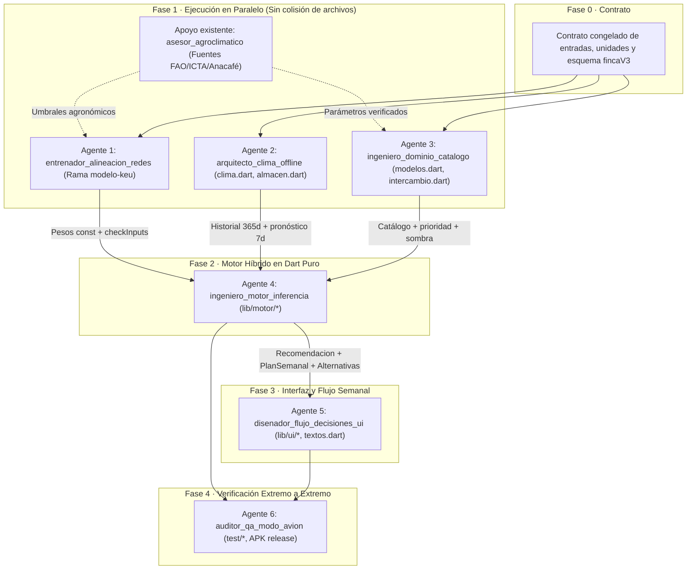

# Compatibilidad y Guía de Agentes · Redes Neuronales (`modelo-keu` → `app/V02`)

Análisis de compatibilidad técnica, puntos de mejora y hoja de ruta por agentes para integrar las redes neuronales de la rama `modelo-keu` dentro de **Field Shift `V02` (`1.3.0+5`)**, operando **100 % en el teléfono** y necesitando **internet únicamente 1 día por semana** (para cargar la semana siguiente y consolidar el historial climático).

---

## 1. Diagnóstico General de Compatibilidad

* **Ejecución en el teléfono (CPU, RAM, APK, Flutter):** **Muy alta.** Las redes exportadas en `modelo-keu` son perceptrones multicapa muy pequeños (entre 3,713 y 5,731 parámetros; `< 200 KB` cada una en JSON) y ya cuentan con pase hacia adelante en **Dart puro** (`modelo-keu:scripts/app/dart/red.dart`, solo `dart:math`), compatible con el SDK `^3.14.0` de [pubspec.yaml](pubspec.yaml). No requieren TensorFlow Lite, ONNX Runtime ni ExecuTorch, pesan en conjunto `< 550 KB` y se ejecutan en `< 0.2 ms` en CPU.
* **Esquema de internet 1 día por semana ("cargar la semana siguiente"):** **Media-Baja con la descarga actual; requiere mejora clave.** Hoy [clima.dart](lib/datos/clima.dart) solo consulta **NASA POWER** hasta `hoy`, que es observación satelital histórica **sin pronóstico futuro** y con **2 a 7 días de rezago**. Sin descargar también un pronóstico de 7–10 días el día de conexión, al sexto día sin internet se acumulan 8–13 días sin datos observados, haciendo caer `rain7` artificialmente hacia `0` y disparando falsas alarmas de sequía.
* **Contrato de datos y motor con `app/V02`:** **Media.** `modelo-keu` se diseñó leyendo `app/V01`, mientras `app/V02` introdujo lluvia anulable (`double?`), eventos de pérdida, campañas múltiples y reparto de agua compartida en `m³`. Además, dos de las redes de decisión se entrenaron con ERA5 y cultivos que aún no están en el catálogo de `V02`.

> [!IMPORTANT]
> **Principio rector de integración:** Las redes neuronales **no deben reemplazar** el motor físico FAO-56 ([fao56.dart](lib/motor/fao56.dart)) ni los candados de disponibilidad y reparto de agua de [estado.dart](lib/estado.dart). Deben conectarse como una **capa híbrida en Dart puro** donde FAO-56 gobierna las láminas en `mm` y límites físicos, y las redes aportan anticipación de estrés a 7 días, decisión de riego en café y recomendación de cultivo tras pérdida.

---

## 2. Redes Disponibles en `modelo-keu` y su Rol en Decisiones

| Red en `modelo-keu:web/data/` | Arquitectura y tamaño | Qué predice o decide | Estado frente a `app/V02` |
|---|---|---|---|
| `app_mlp.json` | `40 → 64 → 32 → 16 → 3` (ReLU, 5,283 params, 182 KB) | **Alerta temprana semanal** (`maiz`, `frijol`, `tomate`): predice `estres7` (días con `Ks < 1` en los próximos 7 días, F1 `~0.86` vs `0.69` actual), `estres14` y `factorFinal`. | **Alta** (entrenada con el motor de la app y NASA POWER, pero solo en secano y entre 20 %–80 % del ciclo). |
| `recommender_mlp.json` | `32 → 64 → 32 → 16 → 1` (`tanh`, 4,737 params, 95 KB) | **Decisión tras perder cosecha**: puntúa 8 opciones (`maiz`, `frijol`, `ajonjoli`, `papa`, `cebolla`, `brocoli`, `lechuga`, `fallow`) según estado del lote y prioridad del productor. | **Media-Baja** (5 cultivos + barbecho no existen hoy en [modelos.dart](lib/modelos.dart); entrenada con ERA5 y sin `tomate`). |
| `coffee_ptc_mlp.json` *(supera a `coffee_recommender.json`)* | `16 → 64 → 32 → 16 → 1` (ReLU, 3,713 params, 95 KB) | **Decisión de riego en café** (30/60/90 días post-floración): estima días de estrés evitados al regar 20 mm y decide según prioridad; se complementa con 4 avisos por reglas (`roya`, `minador`, `antracnosis`, `abono`). | **Media** (exige historial desde el 1 de noviembre `~365 días`, atributo de sombra y reentrenamiento con NASA POWER). |
| `emulator_v3_mlp.json` | `47 → 64 → 32 → 16 → 3` (ReLU, 5,731 params, 165 KB) | **Emulador de rotaciones sobre años pasados**: evalúa campañas completas en `15–20` años históricos del sitio. | **Baja sin precarga** (requiere paquete multianual por sitio; además, en contraste con AquaCrop no debe usarse para retrasar la fecha de siembra inicial). |

---

## 3. Diez Puntos de Mejora para Encajar la Compatibilidad

| ID | Capa | Brecha actual | Mejora requerida |
|---|---|---|---|
| **M1** | Sincronización Semanal | [clima.dart](lib/datos/clima.dart) solo baja NASA POWER pasado (con rezago y sin futuro). | **Descarga semanal dual (`< 15 KB/semana`):** el día con internet descargar (1) NASA POWER reciente para consolidar observaciones reales y (2) **pronóstico diario de 7–10 días** (p. ej. Open-Meteo: `Tmax, Tmin, HR, viento, radiación, lluvia`), marcando cada `DiaClima` con `origen: observadoPower \| pronosticoSemanal \| manualProductor` para sobrescribir el pronóstico en la siguiente carga semanal. |
| **M2** | Caché Local y Climatología | `sincronizar()` en [estado.dart](lib/estado.dart) corta en **240 días**, insuficiente para café (desde 1 nov) y pérdida anual (desde 1 abr). | **Ventana incremental de 365 días + 24 medianas del sitio:** conservar 365 días pasados + 10 futuros en [almacen.dart](lib/datos/almacen.dart) (`~45 KB` en JSON) bajando cada semana solo el tramo nuevo, y guardar una sola vez al crear la finca las **24 medianas mensuales históricas** (`Tmax` y `Tmax - Tmin`) para avisos de roya y minador. |
| **M3** | Entrenamiento ML (`modelo-keu`) | `recommender_mlp` y `coffee_ptc_mlp` se entrenaron con **ERA5** y temperatura corregida por DEM (`-0.0065 °C/m`), mientras la app usa **NASA POWER** (+13 % a +40 % más lluvia en pilotos) y celda. | **Reentrenamiento sobre NASA POWER + cola semanal:** reentrenar `recommender_mlp` y `coffee_ptc_mlp` con NASA POWER e incluir en validación/entrenamiento colas de 2–7 días con rezago/pronóstico para asegurar estabilidad durante los 6 días sin internet. |
| **M4** | Catálogo de Cultivos | [modelos.dart](lib/modelos.dart) solo incluye `maiz`, `frijol`, `tomate`, `cafe`; `recommender_mlp` sugiere `ajonjoli`, `papa`, `cebolla`, `brocoli`, `lechuga`, `fallow`, sin `tomate`. | **Alineación de catálogo y acciones:** incorporar en `modelos.dart` las fichas verificadas de los cultivos recomendables más el estado `barbecho` (`fallow`), e incluir `tomate` en el reentrenamiento de `recommender_mlp`. |
| **M5** | Puente `V01` ↔ `V02` | En `V02`, `DiaAgua.lluvia` es `double?` ([fao56.dart](lib/motor/fao56.dart)) y `factorRendimiento` en [recomendador.dart](lib/motor/recomendador.dart) devuelve `null` si falta algún día de lluvia. | **Constructor de entradas a prueba de nulos (`entradas_red.dart`):** resolver explícitamente lluvia nula/pronosticada y calcular `factorSoFar` numérico interno para `app_mlp` sin alterar la regla visual de `V02` que oculta `factorRendimiento` cuando faltan lluvias observadas. |
| **M6** | Motor de Inferencia | [Integración RN apps.md](Integración%20RN%20apps.md) planteaba ExecuTorch (`.pte` + canal Kotlin) pensado para otra arquitectura. | **Dart puro con pesos compilados:** copiar `modelo-keu:scripts/app/dart/red.dart` a `lib/motor/red.dart` y exportar pesos con script automático a archivos `const` (`pesos_*.dart`), con validación `comprobarEntradas` y `checkInputs` en `flutter test`. |
| **M7** | Guardarraíles de Decisión | `app_mlp` solo es válida en secano (20 %–80 % del ciclo) y `V02` gestiona riego diario y saldo compartido en `m³`. | **Orquestador híbrido:** invocar cada red solo dentro de su dominio válido; usar `estres7 >= 0.5` para elevar preventivamente el estado a atención, pero mantener FAO-56 + `DisponibilidadAgua` + `limitarRiego` como autoridad final de lámina y factibilidad. |
| **M8** | Esquema `fincaV3` | Faltan en `V02` la **prioridad del productor**, el **tipo de sombra en café** y un ajuste manual de lluvia local en días sin red. | **Extensión retrocompatible:** añadir `PrioridadProductor`, `TipoSombra` (`ninguna`, `perenne`, `caduca`) y registro ligero de lluvia local en `modelos.dart` e `intercambio.dart` con valores por omisión que no rompan `fincaV3`/`fincaV2`. |
| **M9** | Plan Semanal Offline | `recomendar(...)` solo entrega el estado de `hoy`. | **Proyección de 7 días (`PlanSemanal`):** evaluar día por día `hoy .. hoy + 7` sobre el pronóstico guardado y recalcular en microsegundos en el teléfono cada vez que el agricultor registre riego, lluvia o pérdida a mitad de semana. |
| **M10** | Interfaz Rural (`V02`) | Falta mostrar el horizonte semanal, los avisos con confianza en café y las opciones de resiembra al registrar `TipoEvento.perdida`. | **Integración UX en `<= 2` toques:** conectar las salidas en [hoy.dart](lib/ui/hoy.dart) y [flujo.dart](lib/ui/flujo.dart) (`PantallaMiPlantacion`) respetando componentes propios ([emergentes.dart](lib/ui/emergentes.dart)), texto `>= 18 px` y escalado `2.0x`–`3.2x`. |

---

## 4. Arquitectura de Agentes y Orden de Trabajo

Se definen **6 agentes especializados** con fronteras estrictas de archivos para evitar conflictos de fusión, apoyados por el perfil existente [asesor_agroclimatico.toml](../../.codex/agents/asesor_agroclimatico.toml).

---

## 5. Rol y Tareas de cada Agente

### Agente 1 · `entrenador_alineacion_redes`
* **Rol:** Especialista en entrenamiento, validación sin fuga temporal y exportación de redes en `modelo-keu`.
* **Archivos propios:** `scripts/app/*`, `scripts/coffee/*`, `scripts/gpu/*`, `web/data/*.json` y nuevo script `scripts/app/export_pesos_dart.mjs` en la rama `modelo-keu`.
* **No debe tocar:** Código de `app/V02/` (solo entrega los archivos generados `pesos_*.dart`).
* **Tareas:**
  1. Reentrenar `recommender_mlp` y `coffee_ptc_mlp` usando series **NASA POWER** (mismos 6 parámetros y convención de celda de la app) en semillas `17, 29, 43`, incorporando `tomate` al espacio de acciones de pérdida.
  2. Evaluar la sensibilidad de `app_mlp`, `coffee_ptc_mlp` y `recommender_mlp` cuando los últimos 2–5 días tienen rezago satelital y los siguientes 7 días provienen de pronóstico semanal; incorporar esa condición al entrenamiento si cae el desempeño.
  3. Conservar de `app_mlp` solo las salidas que mejoran al motor base (`estres7` y `estres14`, descartando `factorFinal` donde FAO-33 tiene menor MAE).
  4. Generar automáticamente los archivos Dart `const` con pesos, `inputNames`, `mean`, `std`, `yMean`, `yStd`, hash de commit y 20 casos `checkInputs`/`checkPredictions` verificados a `< 1e-5`.
* **Prompt base:**
  > Eres `entrenador_alineacion_redes` de Field Shift Guatemala. Trabajas exclusivamente en el pipeline de entrenamiento y evaluación de `modelo-keu`. Tu objetivo es alinear `app_mlp`, `coffee_ptc_mlp` y `recommender_mlp` con las variables exactas de NASA POWER y el régimen de carga semanal de la app móvil, sin usar jamás información futura posterior al día de decisión, manteniendo las semillas 17/29/43 y exportando pesos reproducibles con vectores de prueba para Dart puro.

---

### Agente 2 · `arquitecto_clima_offline`
* **Rol:** Ingeniero de sincronización semanal dual (NASA POWER + pronóstico 7 días) y persistencia local ligera.
* **Archivos propios:** [lib/datos/clima.dart](lib/datos/clima.dart), [lib/datos/almacen.dart](lib/datos/almacen.dart) y método `sincronizar()` en [lib/estado.dart](lib/estado.dart).
* **No debe tocar:** `lib/motor/*` ni `lib/ui/*`.
* **Tareas:**
  1. Añadir a `DiaClima` el origen del dato (`observadoPower`, `pronosticoSemanal`, `manualProductor`) con serialización retrocompatible en `fincaV3`.
  2. Integrar en `ServicioClima` la descarga del pronóstico diario de 7–10 días ("la semana siguiente", p. ej. Open-Meteo sin API key), convirtiendo viento de 10 m a 2 m (FAO-56 ec. 47) y radiación a `MJ/m²/día`, con manejo de fallos independiente respecto a NASA POWER.
  3. Ampliar `Almacen` a **365 días pasados + 10 futuros** con descarga incremental (`< 20 KB` por sincronización semanal), asegurando que `observadoPower` reemplace automáticamente a `pronosticoSemanal` en la siguiente conexión semanal.
  4. Guardar una sola vez por ubicación de finca los **24 escalares** de medianas mensuales históricas (`Tmax` y amplitud térmica) requeridos por los avisos de roya y minador en café.
  5. Separar opcionalmente el permiso de red para permitir sincronizar el clima semanal (`< 20 KB`) con datos móviles si el usuario lo habilita, manteniendo solo-wifi para teselas de mapa.
* **Prompt base:**
  > Eres `arquitecto_clima_offline` en `app/V02`. Diseñas la descarga semanal y el almacenamiento local para que el teléfono funcione toda la semana sin señal. Combina observaciones consolidadas de NASA POWER con pronóstico diario de 7–10 días en unidades exactas de FAO-56, mantén el tráfico semanal por debajo de 20 KB mediante sincronización incremental de 365 días, etiqueta el origen de cada día climático y preserva intacto el blindaje anticorrupción `fincaV3.respaldoCorrupto`.

---

### Agente 3 · `ingeniero_dominio_catalogo`
* **Rol:** Responsable del modelo de datos `fincaV3`, catálogo agronómico verificado e intercambio de paquetes JSON.
* **Archivos propios:** [lib/modelos.dart](lib/modelos.dart), [lib/eventos.dart](lib/eventos.dart) y `lib/intercambio.dart`.
* **Apoyo:** Validar parámetros con [asesor_agroclimatico.toml](../../.codex/agents/asesor_agroclimatico.toml).
* **Tareas:**
  1. Verificar con fuentes primarias (FAO-56, FAO-33, ICTA, Anacafé) los parámetros de `tomate` y `cafe` en `catalogo`, y añadir las fichas de `ajonjoli`, `papa`, `cebolla`, `brocoli`, `lechuga` y `barbecho` (`fallow`), eliminando caídas silenciosas a `maiz` en `cultivoPorId`.
  2. Agregar `PrioridadProductor` (`equilibrado`, `cauto`) y `TipoSombra` (`ninguna`, `perenne`, `caduca` para café) en `Plantacion`/`Parcela` con valores por defecto seguros.
  3. Soportar el registro ligero de lluvia local observada por el productor en días sin conexión para corregir desvíos del pronóstico semanal.
  4. Actualizar `aJson`/`deJson` e `intercambio.dart` garantizando lectura limpia de estados `fincaV3` y `fincaV2` previos.
* **Prompt base:**
  > Eres `ingeniero_dominio_catalogo` en `app/V02`. Mantienes `lib/modelos.dart`, `lib/eventos.dart` y `lib/intercambio.dart`. Alinea el catálogo de cultivos, prioridades del productor, sombra de café y observaciones locales con el contrato de las redes neuronales, respaldando cada parámetro agronómico con fuente documentada y garantizando retrocompatibilidad total con `fincaV3` y `fincaV2`.

---

### Agente 4 · `ingeniero_motor_inferencia`
* **Rol:** Desarrollador del motor híbrido en Dart puro (`FAO-56 + Redes + Avisos de Café + Plan Semanal`).
* **Archivos propios:** [lib/motor/fao56.dart](lib/motor/fao56.dart), [lib/motor/recomendador.dart](lib/motor/recomendador.dart) y nuevos archivos puros `lib/motor/red.dart`, `lib/motor/pesos_*.dart`, `lib/motor/entradas_red.dart`, `lib/motor/cafe.dart`, `lib/motor/plan_semanal.dart`.
* **Restricción estricta:** Cero imports de `package:flutter/*` en `lib/motor/`.
* **Tareas:**
  1. Integrar `red.dart` (`predecirCapas`, `correccionPlana`, `tanh`, `comprobarEntradas`) y los archivos `pesos_*.dart`.
  2. Construir en `entradas_red.dart` las 40 entradas de `app_mlp` (resolviendo `DiaAgua.lluvia` anulable y `factorSoFar`), las 16 de `coffee_ptc_mlp` y las `32 × N` acciones de `recommender_mlp`.
  3. Portar en `cafe.dart` el ajuste hídrico por sombra (`plotAdjust`), la estimación de floración por lluvia, los 4 avisos con fuente/confianza (`roya`, `minador`, `antracnosis`, `abono`) y la regla/red `coffee_ptc_mlp`.
  4. Orquestar en `recomendar(...)` las compuertas de dominio (anuales en secano 20 %–80 %, café establecido, pérdida de campaña con `recomendarTrasPerdida(...)`) manteniendo siempre los límites de `DisponibilidadAgua` y `limitarRiego` sobre cualquier sugerencia de riego.
  5. Implementar `PlanSemanal` proyectando `hoy .. hoy + 7` sobre el pronóstico guardado para entregar recomendaciones accionables durante los 6 días sin internet (`< 5 ms` para toda la finca).
* **Prompt base:**
  > Eres `ingeniero_motor_inferencia` en `app/V02/lib/motor/`. Escribes exclusivamente Dart puro (`dart:math`, sin Flutter). Integra las redes neuronales de `modelo-keu` y el módulo de café sobre el motor FAO-56 actual respetando guardarraíles físicos estrictos: ninguna red puede sugerir regar sin agua disponible ni fuera de su dominio medido, y el `PlanSemanal` debe recalcularse localmente en milisegundos ante cualquier registro del productor.

---

### Agente 5 · `disenador_flujo_decisiones_ui`
* **Rol:** Especialista UX/UI Cupertino de alto contraste y baja fricción (`V02`).
* **Archivos propios:** [lib/ui/hoy.dart](lib/ui/hoy.dart), [lib/ui/flujo.dart](lib/ui/flujo.dart), `lib/ui/plantacion.dart`, `lib/ui/agua.dart`, `lib/ui/ajustes.dart` y [lib/textos.dart](lib/textos.dart).
* **Restricciones UX obligatorias:** Solo `cupertino_ui`, `tema.dart` y [emergentes.dart](lib/ui/emergentes.dart); máximo **2 toques** hacia cualquier acción principal; tipografía `>= 18 px`; zonas táctiles `>= 56 px`; sin desbordamientos en `2.0x` y `3.2x` (vertical y horizontal); español e inglés con soporte de manzanas.
* **Tareas:**
  1. Mostrar en `PestanaHoy` el estado de cobertura de la semana offline (*días restantes con pronóstico cargado*), el resumen de los **próximos 7 días** y las alertas tempranas de estrés hídrico, diferenciando dato observado vs pronosticado.
  2. Incorporar en `plantacion.dart` el selector de sombra y sugerencia de floración para café, y presentar en `Hoy` los avisos de roya, minador, antracnosis y abono con su fuente y nivel de confianza.
  3. Conectar en `PantallaMiPlantacion` ([flujo.dart](lib/ui/flujo.dart)) el asistente post-pérdida (`recommender_mlp`) al registrar `TipoEvento.perdida` o cerrar campaña anticipadamente, permitiendo iniciar la nueva siembra recomendada en el mismo lote en 1 toque.
  4. Añadir el selector de `PrioridadProductor` y el registro rápido de lluvia local observada, con todas las cadenas bilingües en `textos.dart`.
* **Prompt base:**
  > Eres `disenador_flujo_decisiones_ui` en `app/V02`. Presentas el plan semanal sin conexión, los avisos de café y las recomendaciones de cambio de cultivo tras pérdida usando únicamente `cupertino_ui`, `tema.dart` y `emergentes.dart`. Cumple sin excepción la regla de máximo 2 toques, cuerpos >= 18 px, controles >= 56 px, cero overflow hasta `3.2x` y textos claros en español e inglés.

---

### Agente 6 · `auditor_qa_modo_avion`
* **Rol:** Auditor de paridad numérica, simulación de ciclo semanal sin internet y regresión integral.
* **Archivos propios:** `test/*` (nuevas suites `test/red_motor_test.dart`, `test/semana_offline_test.dart` y revisión de `test/capturas/`).
* **Tareas:**
  1. Verificar en `red_motor_test.dart` la paridad `< 1e-5` de todas las redes contra `checkInputs`/`checkPredictions`, estabilidad numérica (`tanh(±800)`), fallo explícito ante entradas desordenadas y respeto a `DisponibilidadAgua.no`.
  2. Simular en `semana_offline_test.dart` un ciclo completo **Domingo (wifi) → Lunes a Sábado (modo avión con registros de riego, lluvia manual y pérdida de cultivo) → Domingo siguiente (wifi consolidando NASA POWER sobre pronóstico)** usando reloj y servicio simulados.
  3. Probar degradación limpia a los **14 días sin internet** (pronóstico vencido) y ante caída parcial del servidor de pronóstico.
  4. Ejecutar `flutter analyze`, verificar las **220 pruebas existentes + nuevas suites** en verde y comprobar el tamaño y arranque del APK `--release`.
* **Prompt base:**
  > Eres `auditor_qa_modo_avion` en `app/V02/test/`. Validas con pruebas deterministas sin red real que las redes en Dart puro coinciden con PyTorch a `1e-5`, operan 7 días en modo avión recalculando al instante ante eventos locales, degradan con seguridad si pasan más de 7 días sin señal, y mantienen en verde las 220 pruebas previas y las reglas de accesibilidad de `V02`.

---

## 6. Decisiones Previas a Confirmar en Fase 0

> [!WARNING]
> Confirmar estos tres puntos antes de ejecutar la Fase 1 evita retrabajo entre el reentrenamiento en `modelo-keu` y la interfaz en `app/V02`.

1. **Proveedor del pronóstico de 7 días:** usar **Open-Meteo** (recomendado: gratuito, sin API key en el APK, `~3 KB` por consulta diaria con radiación solar incluida) frente a **Meteomatics** (ver `D12` en [decisions.md](../../proyecto/decisions.md)).
2. **Catálogo de resiembra en `V02`:** incorporar los 5 cultivos adicionales de `modelo-keu` (`ajonjoli`, `papa`, `cebolla`, `brocoli`, `lechuga`) + `barbecho` + `tomate`, o acotar el reentrenamiento de `recommender_mlp` a un subconjunto menor.
3. **Botón rápido de lluvia local offline:** confirmar si se incluye *«Hoy llovió en mi finca»* para corregir localmente el pronóstico durante los 6 días sin internet.
