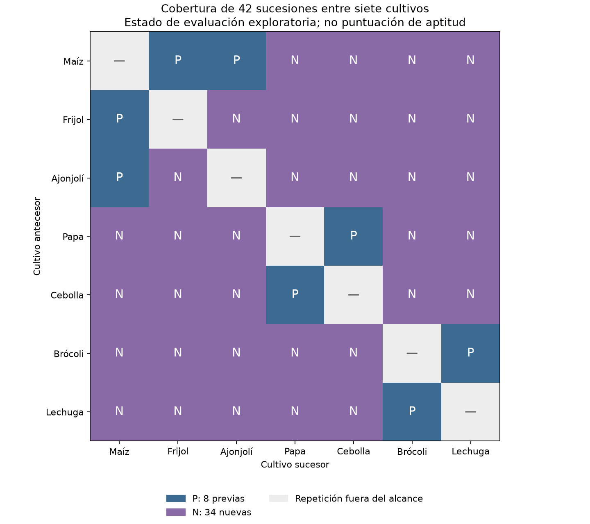

# Combinaciones pendientes de siete cultivos · Chiquimula · 2025

**Fecha:** 15 de noviembre de 2026. Esta entrega completa las **34 sucesiones pendientes**, agrupadas en **17 parejas evaluadas en ambos órdenes**. Con las **8 sucesiones anteriores** queda cubierta la evaluación exploratoria de las **42 sucesiones entre cultivos distintos** de maíz, frijol, ajonjolí, papa, cebolla, brócoli y lechuga.

**Alcance científico:** cobertura de evaluación no equivale a 42 rotaciones aprobadas. Cada dirección tiene resultados de calendario/agua, exposición climática y condiciones documentales. Compatibilidad sanitaria, adaptación de variedad, rendimiento y viabilidad comercial necesitan validación local. Los otros 11 cultivos del catálogo de 18 y las siete repeticiones quedan fuera de esta entrega.

Se evaluaron **4,200 calendarios nuevos**: **1,884 completos** y **2,316 fuera de cobertura de 2025**. Se ejecutaron **271,296 corridas hídricas nuevas**, **135,648 comparaciones pareadas** y **99,023,040 pasos diarios**.



La [matriz CSV](resultados/cobertura_42_sucesiones.csv) y el [JSON](resultados/cobertura_42_sucesiones.json) tienen una fila por dirección y enlace a su auditoría. P indica evaluación previa y N evaluación nueva; los colores no expresan aptitud o riesgo. Las ocho previas conservan su malla y versiones originales. Las cifras entre carpetas no conforman un ranking homogéneo sin armonizar fechas y supuestos.

## Los 17 informes nuevos

Cada enlace incluye ambas direcciones, datos numéricos, gráficas, fuentes y condiciones pendientes. Por ejemplo, maíz↔cebolla comprende maíz→cebolla y cebolla→maíz.

| Pareja, ambos órdenes | Calendarios | Completos en 2025 | Corridas hídricas |
|---|---:|---:|---:|
| [Maíz ↔ Papa](parejas/maiz_papa/README.md) | 168 | 70 | 10,080 |
| [Maíz ↔ Cebolla](parejas/maiz_cebolla/README.md) | 168 | 34 | 4,896 |
| [Maíz ↔ Brócoli](parejas/maiz_brocoli/README.md) | 252 | 148 | 21,312 |
| [Maíz ↔ Lechuga](parejas/maiz_lechuga/README.md) | 168 | 108 | 15,552 |
| [Frijol ↔ Ajonjolí](parejas/frijol_ajonjoli/README.md) | 336 | 180 | 25,920 |
| [Frijol ↔ Papa](parejas/frijol_papa/README.md) | 168 | 102 | 14,688 |
| [Frijol ↔ Cebolla](parejas/frijol_cebolla/README.md) | 168 | 50 | 7,200 |
| [Frijol ↔ Brócoli](parejas/frijol_brocoli/README.md) | 252 | 184 | 26,496 |
| [Frijol ↔ Lechuga](parejas/frijol_lechuga/README.md) | 168 | 136 | 19,584 |
| [Ajonjolí ↔ Papa](parejas/ajonjoli_papa/README.md) | 336 | 104 | 14,976 |
| [Ajonjolí ↔ Cebolla](parejas/ajonjoli_cebolla/README.md) | 336 | 48 | 6,912 |
| [Ajonjolí ↔ Brócoli](parejas/ajonjoli_brocoli/README.md) | 504 | 226 | 32,544 |
| [Ajonjolí ↔ Lechuga](parejas/ajonjoli_lechuga/README.md) | 336 | 170 | 24,480 |
| [Papa ↔ Brócoli](parejas/papa_brocoli/README.md) | 252 | 128 | 18,432 |
| [Papa ↔ Lechuga](parejas/papa_lechuga/README.md) | 168 | 92 | 13,248 |
| [Cebolla ↔ Brócoli](parejas/cebolla_brocoli/README.md) | 252 | 58 | 8,352 |
| [Cebolla ↔ Lechuga](parejas/cebolla_lechuga/README.md) | 168 | 46 | 6,624 |

## Entradas y método común

Se conserva el candidato **14.8250, −89.5312**, elegido por el usuario, con los originales congelados del commit `ef51faf83a975656a927bc4934673b668c3a94e9`. El DSM da **373 m**, pendiente local aproximada de 2.6%; SoilGrids estima **130.7 mm de agua disponible en 0–100 cm** y pH superficial cercano a 7. Son estimaciones cartográficas, sin linderos o mediciones de finca confirmados.

La meteorología de 2025 incluye NASA POWER, IMERG V07 **Late**, CHIRPS v2 y ERA5. Las API no se consultaron de nuevo. ET0 se calcula con FAO-56 y meteorología POWER, con presión estimada a 373 m; la temperatura regional no se corrige arbitrariamente por altitud. Las cuatro lluvias son alternativas y no cuatro estaciones o réplicas independientes de campo. GWET, humedad volumétrica ERA5 y agua disponible simulada son magnitudes distintas.

| Cultivo | Producto modelado | Familia | Ciclos supuestos (días) |
|---|---|---|---|
| Maíz | grano seco | Poaceae | 90, 125 |
| Frijol | grano seco | Fabaceae | 70, 95 |
| Ajonjolí | semilla oleaginosa | Pedaliaceae | 100, 110, 150, 180 |
| Papa | tuberculo para consumo | Solanaceae | 115, 130 |
| Cebolla | bulbo seco; no verdeo ni semilla | Amaryllidaceae | 150, 210 |
| Brócoli | inflorescencia fresca; sin cortes laterales prolongados | Brassicaceae | 75, 90, 135 |
| Lechuga | hoja/cabeza fresca, una cosecha | Asteraceae | 75, 105 |

Los [parámetros auditados](datos/cultivos/parametros_auditados.json) preservan etapas, Kc, raíces, p, notas y procedencia. Hay referencias extranjeras y reescalados; no constituyen fenología observada. La inconsistencia de ajonjolí FAO (etapas que suman 110 y total publicado 100) se conserva. En brócoli, 75/90 corresponde a sensibilidad de cosecha principal tras trasplante; 135 es la referencia FAO extranjera. No se usa el ciclo general de 120 días con laterales/semilla como cabeza principal.

Las fechas iniciales son 15 de enero, 1 de marzo, 1/15 de mayo, 1/15 de junio y 1 de septiembre de 2025. Se prueban intervalos de **7/14/21 días completos**. Son escenarios de ocupación del campo, sin almácigo en el sublote. El intervalo incluye retiro/preparación y secado/curado cuando corresponda, sin garantizar su cumplimiento. El cierre del ciclo tampoco garantiza grano seco o liberación efectiva.

Cada calendario completo tiene **144 casos**: cuatro lluvias × tres hipótesis de suelo/raíces × tres escorrentías (0/15/30%) × dos reservas iniciales (25/75%) × secano/riego. Los tres casos de suelo son referencia, profundidad radical limitada a **30 cm** y almacenamiento 25% menor. El límite de 30 cm es una sensibilidad común nueva; algunas auditorías anteriores de granos usaron 40 cm.

El balance conserva agua en cinco capas desde el **1 de enero**, sin reinicio al cosechar. Para cada día calcula lluvia infiltrada, escorrentía supuesta, drenaje, ETc, limitación hídrica, ETa y riego idealizado. Usa raíces por calendario y Kc único. El riego aplica 20 mm netos al superar RAW, con suministro ilimitado; no es una dosis recomendada ni confirma agua entregable.

La [implementación vectorizada](scripts/motor_vectorizado.py) calcula escenarios independientes en columnas, conservando las ecuaciones del [motor original](scripts/motor_hidrico_base.py). Ningún escenario comparte agua con otro. Las pruebas contrastan las 144 variantes de un calendario, los siete cultivos y 48 corridas publicadas con la implementación original.

## Indicadores, evidencia y límites

- **Calendario:** fechas por cultivo y cobertura de datos. Los calendarios que llegan a 2026 se guardan sin rellenar el clima con ceros o extrapolaciones.
- **Agua:** déficit acumulado ETc−ETa, relación ETa/ETc, días Ks<0.95 y riego hipotético. El umbral Ks es descriptivo y no una función validada de daño o pérdida.
- **Temperatura:** POWER aporta media diaria regional; ERA5 usa semisuma Tmax/Tmin como aproximación. Se conservan máximas separadas. Los umbrales de exposición no son límites universales de viabilidad ni temperatura de órgano.
- **Fotoperíodo y labores:** duración astronómica del día y lluvia en intervalos de referencia. No se simulan bulbificación, espigado, secado de grano, días de maquinaria o calidad comercial.
- **Sanidad:** fuentes por cultivo/grupo y alertas potenciales. No se convierten familias o ausencia de una alerta en ruptura sanitaria, inocuidad o un puntaje.

El [registro de criterios](fuentes/criterios_7_cultivos.json) enlaza fuentes primarias, limita la lectura y conserva los antecedentes. Para *Meloidogyne incognita* hay una alerta potencial entre algunos cultivos; para frijol y brócoli parte del respaldo es de grupo. No acredita infección local ni susceptibilidad de todo cultivar. Las combinaciones sin esta alerta siguen requiriendo diagnóstico. Las referencias favorables de ajonjolí o brócoli en otros sistemas no se extrapolan a las parejas nuevas.

No se incorpora un ensayo local específico de cada pareja nueva. Las fechas y raíces no se retrasan por estrés o calor; la temperatura y el fotoperíodo no modifican duración, Kc o rendimiento. El exceso drena instantáneamente, sin anegamiento, nivel freático o flujo lateral. No se modelan residuos, patógenos, fertilidad, fijación/mineralización de N, cosecha, ingresos o costos. Frijol no recibe un crédito fijo de N.

Los conteos de escenarios no son probabilidades de éxito. Un déficit bajo no demuestra aptitud térmica, drenaje adecuado o una cosecha vendible. Las fuentes espaciales y pruebas de software deben contrastarse con mediciones y resultados de campo. Las corridas son sintéticas, sin etiquetas observadas de éxito/fracaso para entrenar una red neuronal.

## Comparación de referencia

Cada pareja utiliza ambos órdenes desde el **1 de marzo**, intervalo de **14 días** y duraciones de referencia explícitas en [configuración](configuracion.json). Hay 16 corridas por pareja: dos órdenes × cuatro lluvias × secano/riego, con suelo de referencia, escorrentía 15% y reserva inicial 25%. Se conservan **5,840 registros diarios por pareja** para verificar continuidad y balance.

La comparación cambia únicamente el orden dentro de cada par equivalente. El número de días y la demanda entre parejas distintas pueden cambiar; no se debe construir un ranking global solo con déficit acumulado. Los siete inicios y todas las duraciones están incluidos en los resultados completos, no únicamente la referencia de marzo.

## Reproducción y controles

Desde esta carpeta, con Python 3.12:

```sh
python -m venv .venv
# Activar el entorno según el sistema operativo.
python -m pip install -r requirements-simulacion.txt
python scripts/auditar_7_cultivos_2025.py
python scripts/redactar_informes.py
python scripts/verificar_paquete.py
```

La simulación lee los originales incluidos, sin credenciales ni nuevas descargas. Si existe `tmp/sim-deps` del workspace, se incorpora al proceso; una copia independiente usa las dependencias fijadas. Las fechas de ejecución e inventarios pueden cambiar. Los scripts de adquisición se conservan como referencia; ejecutarlos otra vez puede descargar otra revisión del producto.

Las **12 pruebas** comprueban cobertura exacta 34+8=42, calendarios de cada dirección, referencias completas, duraciones, intervalos, rechazo de ciclos fuera de 2025, equivalencia vector/escalar, 48 corridas publicadas, límites físicos y separación de media/máxima. El máximo residuo numérico del balance fue **8.53e-14 mm**: prueba contabilidad, no exactitud agronómica.

El [control](control_paquete.json) verifica mallas, conteos, equivalencia de CSV/JSON, referencias diarias, enlaces, cobertura y hashes. El [inventario](inventario.json) identifica los archivos publicados con SHA-256 y SHA de objetos Git; excluye su propia huella. Los originales científicos del [método](resultados/metodo_y_validacion.json), la [configuración](configuracion.json), las [fuentes](fuentes/criterios_7_cultivos.json) y el [resumen general](resultados/resumen_general.json) permiten revisar la entrega.

Antes de recomendar, comprobar material, parcela, fechas reales, almácigo, retiro, residuos, perfil físico, análisis de suelo, drenaje, temperatura y diagnóstico sanitario. Confirmar agua, trabajo/equipo, destino/comprador y costos. Una parcela más fresca o un manejo protegido requiere otra auditoría con sus propias entradas.
