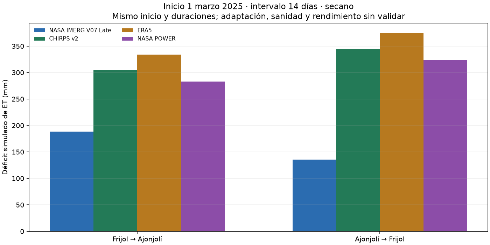

# Auditoría Frijol ↔ Ajonjolí · Chiquimula · 2025

**Direcciones evaluadas:** Frijol → Ajonjolí y Ajonjolí → Frijol. Entrega del 15 de noviembre de 2026, punto **14.8250, −89.5312**. Sucesiones estrictas, sin coexistencia y sin repeticiones. [Volver a la cobertura de los siete cultivos](../../README.md).

**Dictamen:** En la referencia, la dirección directa acumula menor déficit con 3 de las cuatro lluvias y la inversa con 1. Esto describe ese calendario y no una superioridad general. La compatibilidad sanitaria, el rendimiento y la rentabilidad permanecen sin validar. Esta entrega no incorpora un ensayo local específico de esta pareja; compara agua/calendario y conserva las condiciones documentadas por mecanismo.

## Alcance y parámetros

**336 calendarios**; **180 completos** en 2025 y **156 inconclusos**, conservados solo como fechas. Se ejecutaron **25,920 corridas** y **12,960 comparaciones pareadas**. Ambos sentidos tienen la misma cantidad de escenarios.

| Cultivo/producto | Identidad y familia | Kc inicial / medio / final | Raíz | p | Duraciones (días) |
|---|---|---:|---:|---:|---|
| Frijol | Phaseolus vulgaris L. · Fabaceae | 0.4 / 1.15 / 0.35 | 0.6 m | 0.45 | 70, 95 |
| Ajonjolí | Sesamum indicum L. · Pedaliaceae | 0.35 / 1.1 / 0.25 | 1.0 m | 0.6 | 100, 110, 150, 180 |

Los productos, etapas y notas se conservan en [parámetros](../../datos/cultivos/parametros_auditados.json). [FAO-56, tablas 11/12](https://www.fao.org/4/x0490e/x0490e0b.htm) y [tabla 22](https://www.fao.org/4/x0490e/x0490e0e.htm) son referencias sin calibración de parcela. Kc inicial puede proceder del grupo. El cambio de familia no genera premio, veto ni crédito de nitrógeno.

## Caso de referencia

Inicio común **1 de marzo de 2025**, duraciones de referencia Frijol 70 días; Ajonjolí 110 días, **14 días completos** entre cultivos. Perfil de referencia, escorrentía supuesta 15%, reserva al 1 de enero 25%. El agua se conserva entre cultivos.

| Dirección | Primer cultivo | Segundo cultivo |
|---|---|---|
| Frijol → Ajonjolí | 2025-03-01 a 2025-05-09 | 2025-05-24 a 2025-09-10 |
| Ajonjolí → Frijol | 2025-03-01 a 2025-06-18 | 2025-07-03 a 2025-09-10 |

| Lluvia | Déficit directo secano (mm) | Déficit inverso secano (mm) | Días Ks<0.95 directo/inverso | Riego idealizado directo/inverso (mm netos) |
|---|---:|---:|---:|---:|
| IMERG V07 Late | 188.35 | 135.48 | 74 / 65 | 320 / 240 |
| CHIRPS v2 | 305.05 | 344.16 | 93 / 123 | 380 / 420 |
| ERA5 | 333.63 | 374.62 | 102 / 121 | 400 / 440 |
| POWER | 282.65 | 323.97 | 101 / 114 | 340 / 380 |

La última columna corresponde a corridas separadas con pulsos de 20 mm netos al superar RAW y suministro ilimitado; no es una dosis recomendada o agua confirmada. Ver el déficit residual de cada corrida en [referencia](referencia.csv). Un déficit de ET menor no equivale a mayor cosecha o calidad comercial.

En los **6,480 pares de secano** de toda la malla, la inversa tiene mayor déficit en **3,974**, menor en **2,506** y diferencia absoluta de hasta 0.0001 mm en **0**. Estos conteos son escenarios diseñados, sin probabilidad de éxito ni representatividad estadística de fincas.

## Temperatura, establecimiento y operaciones

| Dirección y cultivo | Producto térmico | Media del período (°C) | Días media>24 / total | Días Tmax>30 / total |
|---|---|---:|---:|---:|
| Directa · Frijol | POWER | 25.12 | 46 / 70 | 55 / 70 |
| Directa · Frijol | ERA5 | 28.23 | 68 / 70 | 61 / 70 |
| Directa · Ajonjolí | POWER | 24.52 | 70 / 110 | 38 / 110 |
| Directa · Ajonjolí | ERA5 | 27.81 | 110 / 110 | 105 / 110 |
| Inversa · Ajonjolí | POWER | 25.42 | 80 / 110 | 79 / 110 |
| Inversa · Ajonjolí | ERA5 | 28.65 | 108 / 110 | 101 / 110 |
| Inversa · Frijol | POWER | 24.39 | 46 / 70 | 26 / 70 |
| Inversa · Frijol | ERA5 | 27.53 | 70 / 70 | 67 / 70 |

POWER T2M es media diaria del producto regional. ERA5 usa semisuma Tmax/Tmin, una aproximación diferente. Tmax no equivale a temperatura media ni de órgano. Los umbrales son indicadores descriptivos; no son una función de daño. El fotoperíodo está en [exposición de referencia](exposicion_referencia.csv); es duración astronómica del día, sin respuesta del cultivo ni nubosidad.

Lluvia durante los intervalos de retiro/preparación del caso de referencia:

| Dirección | Intervalo completo | Lluvia | Total (mm) |
|---|---|---|---:|
| Directa | 2025-05-10 a 2025-05-23 | IMERG V07 Late | 115.6 |
| Directa | 2025-05-10 a 2025-05-23 | CHIRPS v2 | 42.9 |
| Directa | 2025-05-10 a 2025-05-23 | ERA5 | 27.5 |
| Directa | 2025-05-10 a 2025-05-23 | POWER | 39.9 |
| Inversa | 2025-06-19 a 2025-07-02 | IMERG V07 Late | 229.9 |
| Inversa | 2025-06-19 a 2025-07-02 | CHIRPS v2 | 165.7 |
| Inversa | 2025-06-19 a 2025-07-02 | ERA5 | 95.6 |
| Inversa | 2025-06-19 a 2025-07-02 | POWER | 79.5 |

Reservar días no demuestra que permitan secado, curado, retiro o entrada de maquinaria. La lluvia acumulada tampoco demuestra anegamiento. El motor drena instantáneamente el exceso; es necesario observar drenaje y humedad reales.

## Condiciones documentales y sanitarias

- **Frijol:** 70 días es sensibilidad prorrateada; no duración universal de una variedad. No se asigna crédito fijo de nitrógeno ni se simula fijación o mineralización. La guía Dry Beans reúne distintos tipos de frijol: hospedaje de grupo no acredita susceptibilidad de cada material guatemalteco.
- **Ajonjolí:** La fila HTML FAO suma 110 días aunque su total dice 100. 100/150/180 son hipótesis reescaladas, sin cultivar local validado. La sensibilidad al anegamiento requiere observación de drenaje; el modelo drena instantáneamente el exceso. 7/14/21 días de intervalo no garantizan secado, cosecha o retiro. La resistencia a nematodos descrita para materiales de otra región no se generaliza a cualquier ajonjolí guatemalteco.

**Sanidad sin resolver para esta pareja.** La revisión selectiva no incorpora una alerta de hospedaje compartido para ambos cultivos en su regla actual. Eso no acredita ausencia de organismos compartidos, inocuidad ni ruptura sanitaria. Ajonjolí y maíz no se clasifican como no hospedantes por falta de una alerta. Hace falta diagnóstico dirigido y comprobar el material.

Fuentes primarias por cultivo y alcance:

- Frijol: [fuente 1](https://www.icta.gob.gt/publicaciones/Frijol/Manual%20de%20producci%C3%B3n%20de%20frijol%20ICTA.pdf), [fuente 2](https://ipm.ucanr.edu/agriculture/dry-beans/nematodes/). Alcance de lectura y límites en [criterios comunes](../../fuentes/criterios_7_cultivos.json).
- Ajonjolí: [fuente 1](https://content.ces.ncsu.edu/sesame-production-fact-sheet), [fuente 2](https://www.maga.gob.gt/sitios/diplan/download/informacion_del_sector/fichasdemercado/Ajonjol%C3%AD%20de%20Primera%20Mayorista.pdf). Alcance de lectura y límites en [criterios comunes](../../fuentes/criterios_7_cultivos.json).

Los documentos de otra región, las fichas comerciales y la evidencia de grupo conservan sus límites. No se atribuye a esta pareja un efecto experimental no leído, una bonificación de N o un saneamiento automático. La [evidencia común](../../fuentes/criterios_7_cultivos.json) conserva antecedentes y vacíos.

## Archivos y reproducción

- [Resumen](resumen.json), [calendarios CSV](calendarios.csv) y [JSON](calendarios.json), incluidos los inconclusos.
- [Todas las corridas CSV.gz](escenarios.csv.gz) y [JSON.gz](escenarios.json.gz); este último conserva segmentos por cultivo.
- [Comparaciones pareadas](comparacion_pareada.csv.gz): diferencia de déficit inverso menos directo.
- [Referencia CSV](referencia.csv) y [JSON](referencia.json): 16 corridas, dos direcciones × cuatro lluvias × secano/riego.
- [Balances de referencia](balances_referencia.csv.gz): 5,840 registros diarios, con reserva y residuo de balance.
- [Exposición de todos los calendarios completos](exposicion_climatica.csv.gz), [exposición de referencia](exposicion_referencia.csv) e [intervalos](intervalos_referencia.csv).

La metodología, código, versiones, datos y reproducción están en el [README común](../../README.md). Cada calendario completo tiene **144 casos**: cuatro lluvias, tres hipótesis de suelo/raíces, tres escorrentías, dos reservas iniciales y secano/riego. Las fechas son supuestas; almácigo externo, cosecha y liberación real se deben comprobar. Los ciclos fuera de 2025 no se completan con lluvia cero.

El modelo no altera crecimiento o cosecha por estrés, temperatura o fotoperíodo. Tampoco calcula patógenos, residuos, nutrientes, rendimiento o ingresos. Estos resultados son sintéticos, sin etiquetas observadas de éxito/fracaso. El agua contablemente conservada y la equivalencia entre implementaciones no sustituyen validación de campo.
