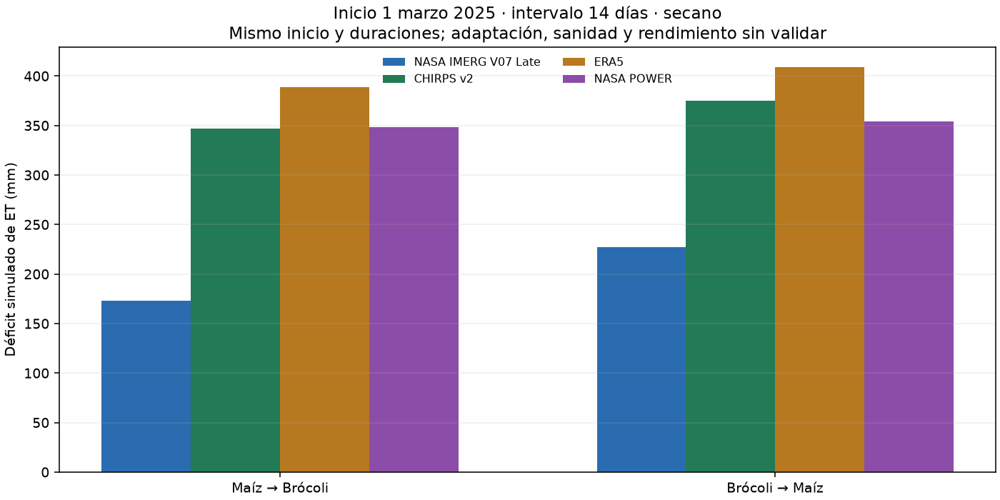

# Auditoría Maíz ↔ Brócoli · Chiquimula · 2025

**Direcciones evaluadas:** Maíz → Brócoli y Brócoli → Maíz. Entrega del 15 de noviembre de 2026, punto **14.8250, −89.5312**. Sucesiones estrictas, sin coexistencia y sin repeticiones. [Volver a la cobertura de los siete cultivos](../../README.md).

**Dictamen:** En la referencia, la dirección directa acumula menor déficit con 4 de las cuatro lluvias y la inversa con 0. Esto describe ese calendario y no una superioridad general. La adaptación al candidato cálido de Brócoli debe comprobarse antes de recomendar la sucesión. La compatibilidad sanitaria, el rendimiento y la rentabilidad permanecen sin validar. Esta entrega no incorpora un ensayo local específico de esta pareja; compara agua/calendario y conserva las condiciones documentadas por mecanismo.

## Alcance y parámetros

**252 calendarios**; **148 completos** en 2025 y **104 inconclusos**, conservados solo como fechas. Se ejecutaron **21,312 corridas** y **10,656 comparaciones pareadas**. Ambos sentidos tienen la misma cantidad de escenarios.

| Cultivo/producto | Identidad y familia | Kc inicial / medio / final | Raíz | p | Duraciones (días) |
|---|---|---:|---:|---:|---|
| Maíz | Zea mays L. · Poaceae | 0.3 / 1.2 / 0.35 | 1.0 m | 0.55 | 90, 125 |
| Brócoli | Brassica oleracea L. (grupo brócoli) · Brassicaceae | 0.7 / 1.05 / 0.95 | 0.5 m | 0.45 | 75, 90, 135 |

Los productos, etapas y notas se conservan en [parámetros](../../datos/cultivos/parametros_auditados.json). [FAO-56, tablas 11/12](https://www.fao.org/4/x0490e/x0490e0b.htm) y [tabla 22](https://www.fao.org/4/x0490e/x0490e0e.htm) son referencias sin calibración de parcela. Kc inicial puede proceder del grupo. El cambio de familia no genera premio, veto ni crédito de nitrógeno.

## Caso de referencia

Inicio común **1 de marzo de 2025**, duraciones de referencia Maíz 90 días; Brócoli 90 días, **14 días completos** entre cultivos. Perfil de referencia, escorrentía supuesta 15%, reserva al 1 de enero 25%. El agua se conserva entre cultivos.

| Dirección | Primer cultivo | Segundo cultivo |
|---|---|---|
| Maíz → Brócoli | 2025-03-01 a 2025-05-29 | 2025-06-13 a 2025-09-10 |
| Brócoli → Maíz | 2025-03-01 a 2025-05-29 | 2025-06-13 a 2025-09-10 |

| Lluvia | Déficit directo secano (mm) | Déficit inverso secano (mm) | Días Ks<0.95 directo/inverso | Riego idealizado directo/inverso (mm netos) |
|---|---:|---:|---:|---:|
| IMERG V07 Late | 173.03 | 226.95 | 68 / 88 | 280 / 340 |
| CHIRPS v2 | 346.92 | 375.02 | 126 / 120 | 400 / 440 |
| ERA5 | 389.04 | 408.63 | 138 / 118 | 460 / 500 |
| POWER | 348.57 | 354.34 | 123 / 123 | 400 / 420 |

La última columna corresponde a corridas separadas con pulsos de 20 mm netos al superar RAW y suministro ilimitado; no es una dosis recomendada o agua confirmada. Ver el déficit residual de cada corrida en [referencia](referencia.csv). Un déficit de ET menor no equivale a mayor cosecha o calidad comercial.

En los **5,328 pares de secano** de toda la malla, la inversa tiene mayor déficit en **2,364**, menor en **2,964** y diferencia absoluta de hasta 0.0001 mm en **0**. Estos conteos son escenarios diseñados, sin probabilidad de éxito ni representatividad estadística de fincas.

## Temperatura, establecimiento y operaciones

| Dirección y cultivo | Producto térmico | Media del período (°C) | Días media>24 / total | Días Tmax>30 / total |
|---|---|---:|---:|---:|
| Directa · Maíz | POWER | 25.55 | 64 / 90 | 73 / 90 |
| Directa · Maíz | ERA5 | 28.65 | 88 / 90 | 81 / 90 |
| Directa · Brócoli | POWER | 24.23 | 50 / 90 | 26 / 90 |
| Directa · Brócoli | ERA5 | 27.49 | 90 / 90 | 85 / 90 |
| Inversa · Brócoli | POWER | 25.55 | 64 / 90 | 73 / 90 |
| Inversa · Brócoli | ERA5 | 28.65 | 88 / 90 | 81 / 90 |
| Inversa · Maíz | POWER | 24.23 | 50 / 90 | 26 / 90 |
| Inversa · Maíz | ERA5 | 27.49 | 90 / 90 | 85 / 90 |

POWER T2M es media diaria del producto regional. ERA5 usa semisuma Tmax/Tmin, una aproximación diferente. Tmax no equivale a temperatura media ni de órgano. Los umbrales son indicadores descriptivos; no son una función de daño. El fotoperíodo está en [exposición de referencia](exposicion_referencia.csv); es duración astronómica del día, sin respuesta del cultivo ni nubosidad.

Lluvia durante los intervalos de retiro/preparación del caso de referencia:

| Dirección | Intervalo completo | Lluvia | Total (mm) |
|---|---|---|---:|
| Directa | 2025-05-30 a 2025-06-12 | IMERG V07 Late | 276.1 |
| Directa | 2025-05-30 a 2025-06-12 | CHIRPS v2 | 138.0 |
| Directa | 2025-05-30 a 2025-06-12 | ERA5 | 148.8 |
| Directa | 2025-05-30 a 2025-06-12 | POWER | 106.5 |
| Inversa | 2025-05-30 a 2025-06-12 | IMERG V07 Late | 276.1 |
| Inversa | 2025-05-30 a 2025-06-12 | CHIRPS v2 | 138.0 |
| Inversa | 2025-05-30 a 2025-06-12 | ERA5 | 148.8 |
| Inversa | 2025-05-30 a 2025-06-12 | POWER | 106.5 |

Reservar días no demuestra que permitan secado, curado, retiro o entrada de maquinaria. La lluvia acumulada tampoco demuestra anegamiento. El motor drena instantáneamente el exceso; es necesario observar drenaje y humedad reales.

## Condiciones documentales y sanitarias

- **Maíz:** 90 días es sensibilidad de ciclo corto con etapas prorrateadas; madurez no garantiza grano seco ni retiro. Si el cultivo siguiente se establece antes de retirar el maíz, corresponde evaluar relevo o coexistencia, fuera de este motor.
- **Brócoli:** Cosecha principal: 75–90 días después del trasplante; etapas prorrateadas. Los 135 días FAO son referencia extranjera separada. El ciclo general que incluye laterales/semilla no se usa como cosecha principal de 120 días. MAGA describe óptimo 16–18 °C y raíz de 30 cm; esta última difiere del rango FAO 0.4–0.6 m. Se prueban hipótesis radicales sin validarlas.

**Sanidad sin resolver para esta pareja.** La revisión selectiva no incorpora una alerta de hospedaje compartido para ambos cultivos en su regla actual. Eso no acredita ausencia de organismos compartidos, inocuidad ni ruptura sanitaria. Ajonjolí y maíz no se clasifican como no hospedantes por falta de una alerta. Hace falta diagnóstico dirigido y comprobar el material.

Fuentes primarias por cultivo y alcance:

- Maíz: [fuente 1](https://www.icta.gob.gt/publicaciones/Maiz/Recomendaciones%20tecnicas%20para%20el%20cultivo%20de%20maiz%20en%20el%20oriente%20de%20Guatemala%202015.pdf). Alcance de lectura y límites en [criterios comunes](../../fuentes/criterios_7_cultivos.json).
- Brócoli: [fuente 1](https://guatemalanosedetiene.gt/wp-content/uploads/2024/06/FICHA-TECNICA-AGROCLIMATICA-BROCOLI.pdf), [fuente 2](https://ipm.ucanr.edu/agriculture/cole-crops/nematodes/). Alcance de lectura y límites en [criterios comunes](../../fuentes/criterios_7_cultivos.json).

Los documentos de otra región, las fichas comerciales y la evidencia de grupo conservan sus límites. No se atribuye a esta pareja un efecto experimental no leído, una bonificación de N o un saneamiento automático. La [evidencia común](../../fuentes/criterios_7_cultivos.json) conserva antecedentes y vacíos.

## Archivos y reproducción

- [Resumen](resumen.json), [calendarios CSV](calendarios.csv) y [JSON](calendarios.json), incluidos los inconclusos.
- [Todas las corridas CSV.gz](escenarios.csv.gz) y [JSON.gz](escenarios.json.gz); este último conserva segmentos por cultivo.
- [Comparaciones pareadas](comparacion_pareada.csv.gz): diferencia de déficit inverso menos directo.
- [Referencia CSV](referencia.csv) y [JSON](referencia.json): 16 corridas, dos direcciones × cuatro lluvias × secano/riego.
- [Balances de referencia](balances_referencia.csv.gz): 5,840 registros diarios, con reserva y residuo de balance.
- [Exposición de todos los calendarios completos](exposicion_climatica.csv.gz), [exposición de referencia](exposicion_referencia.csv) e [intervalos](intervalos_referencia.csv).

La metodología, código, versiones, datos y reproducción están en el [README común](../../README.md). Cada calendario completo tiene **144 casos**: cuatro lluvias, tres hipótesis de suelo/raíces, tres escorrentías, dos reservas iniciales y secano/riego. Las fechas son supuestas; almácigo externo, cosecha y liberación real se deben comprobar. Los ciclos fuera de 2025 no se completan con lluvia cero.

El modelo no altera crecimiento o cosecha por estrés, temperatura o fotoperíodo. Tampoco calcula patógenos, residuos, nutrientes, rendimiento o ingresos. Estos resultados son sintéticos, sin etiquetas observadas de éxito/fracaso. El agua contablemente conservada y la equivalencia entre implementaciones no sustituyen validación de campo.
