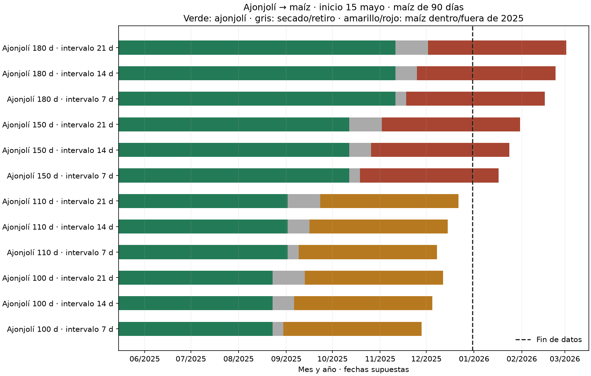
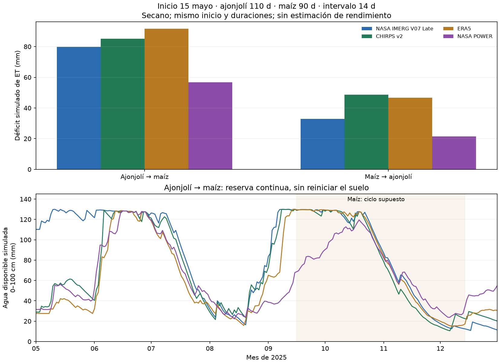

# Auditoría ajonjolí → maíz · Chiquimula · 2025

**Fecha:** 15 de noviembre de 2026. Se audita la dirección solicitada **ajonjolí→maíz**, con el mismo candidato agrícola **14.8250, −89.5312** y los mismos datos abiertos de 2025 de las pruebas anteriores. El comparador **maíz→ajonjolí** se recalcula con condiciones equivalentes. Esta es una simulación retrospectiva exploratoria, sin mediciones de una finca ni validación de rendimiento.

**Dictamen:** el orden inverso merece una evaluación propia. En el caso de referencia lleva el maíz al 16 de septiembre y muestra mayor déficit de evapotranspiración que maíz→ajonjolí con las cuatro lluvias utilizadas. La ventaja cambia en otros calendarios y supuestos. No se aprueba la compatibilidad sanitaria, comercial ni agronómica de la parcela. Lo decisivo sigue siendo la duración real del ajonjolí, su cosecha y retiro, la ventana del maíz y el agua disponible al final del año.

## Alcance y resultado verificable

| Comprobación | Resultado | Límite para decidir |
|---|---|---|
| Calendario | 192 programas: 96 por dirección. Completan el ciclo supuesto en 2025 **21 por dirección**. | Los otros 75 por dirección solo tienen fechas; no se inventó clima de 2026. Completar el ciclo no demuestra cosecha seca. |
| Agua | **6,048 corridas**, 3,024 por dirección; **3,024 comparaciones pareadas**. | Balance simplificado de cinco capas; sin calibración local. Déficit de ET no equivale a pérdida de rendimiento. |
| Secado y liberación | Se prueban intervalos de **7, 14 y 21 días completos**. | En la inversa incluyen secado, retiro y preparación. No garantizan que el terreno esté libre y transitable. |
| Adaptación y sanidad | Maíz: *Zea mays* L., Poaceae. Ajonjolí: *Sesamum indicum* L., Pedaliaceae, conforme a la evidencia previa. | El cambio de familia no demuestra ruptura de patógenos, efecto de residuos ni compatibilidad local. |
| Drenaje y establecimiento | Se conserva el perfil cartográfico y la continuidad del agua. | El drenaje instantáneo supuesto impide simular anegamiento. No se simulan germinación ni secado de grano. |
| Mercado y manejo | Se conservan las fuentes MAGA/ICTA y sus límites. | Sin comprador, costos, fertilización, diagnóstico sanitario o riego verificados. |

## Fuentes que sostienen la revisión

El [registro de evidencia de esta dirección](fuentes/evidencia_bibliografica.json) separa lo leído en la fuente original, los supuestos y lo no demostrado. La [evidencia de la auditoría anterior](fuentes/evidencia_previa_maiz_ajonjoli.json) se conserva identificada como tal.

- **Maíz en el oriente guatemalteco.** La [guía ICTA de 2015](https://www.icta.gob.gt/publicaciones/Maiz/Recomendaciones%20tecnicas%20para%20el%20cultivo%20de%20maiz%20en%20el%20oriente%20de%20Guatemala%202015.pdf), que incluye Chiquimula, vincula la época principal de siembra con el establecimiento de lluvias, normalmente a finales de mayo o principios de junio. También contempla siembra con riego en otras épocas. Describe ICTA B-5 con tres meses de ciclo y otros materiales con cuatro; exige maíz seco para cosechar. **No prueba que toda siembra de septiembre sea inviable**, ni convierte tres meses en 90 días exactos de ocupación de parcela. Las etapas del modelo de 90 días son una sensibilidad, no fenología validada de B-5.
- **Madurez y cosecha del ajonjolí.** La [guía de NC State de marzo de 2026](https://content.ces.ncsu.edu/sesame-production-fact-sheet) distingue madurez de la semilla y secado posterior antes de cosechar. Sus referencias aproximadas de 100 días y 7–14 días adicionales son de Carolina del Norte. Se exploran 7/14/21 días para secado y operaciones; no se trasladan fechas de siembra, agroquímicos, precios ni condiciones de esa región a Guatemala. La guía también advierte sobre sensibilidad al anegamiento. Su advertencia acerca de residuos al implantar ajonjolí **no demuestra toxicidad del residuo de ajonjolí sobre maíz**. Es literatura consultada en 2026 para una revisión retrospectiva, sin afirmar que estuviera disponible en 2025.
- **Parámetros y discrepancia de duración.** La [tabla 11 HTML de FAO-56](https://www.fao.org/4/x0490e/x0490e0b.htm) muestra para Sesame etapas 20/30/40/20, cuya suma es **110**, aunque indica **100** en el total. Se conservan 110 por suma y 100 reescalado como hipótesis separadas. Los ciclos de 150/180 se mantienen de la ficha comercial MAGA ya contrastada, sin adoptarlos como cultivar local. La misma tabla aporta la referencia extranjera de maíz de 125 días. Los [parámetros auditados](datos/cultivos/parametros_auditados.json) detallan Kc y etapas; la [tabla 22 FAO](https://www.fao.org/4/x0490e/x0490e0e.htm) respalda referencias de raíces y agotamiento de agua. Ambos cultivos se limitan a 1 m por el perfil disponible. No se añade agua bajo esa profundidad.

La revisión fue selectiva. No se presenta como ensayo guatemalteco de la sucesión inversa. Un artículo sanitario cuyo texto completo devolvió 403 quedó excluido de las afirmaciones. La ficha MAGA de mercado, la memoria ICTA y las otras fuentes heredadas mantienen sus límites documentados; no se vuelven pruebas de ajonjolí→maíz por cambiar el título de la auditoría.

## Entorno y datos

Se reutilizan los originales conservados en [datos/escenarios/chiquimula_2025](datos/escenarios/chiquimula_2025): 365 días de **NASA POWER, IMERG V07 Late, CHIRPS v2 y ERA5**, suelo SoilGrids y cartografía MAGA/JAXA/WorldCover. Las API no se consultaron de nuevo; así, las diferencias entre auditorías proceden del calendario y del cultivo. Los scripts de descarga se incluyen como referencia de adquisición; ejecutarlos de nuevo puede devolver otra revisión de los productos.

El candidato está en una unidad temática MAGA de maíz/frijol, sin linderos de finca confirmados. El DSM da 373 m y pendiente local aproximada de 2.6%; SoilGrids estima **130.7 mm de agua disponible en 0–100 cm**, con pH superficial aproximado de 7. Son estimaciones espaciales estáticas, no análisis de suelo de 2025. Pendiente y clasificación aluvial no miden drenaje, compactación, salinidad, nivel freático o inundación.

Las lluvias anuales difieren: IMERG **2,243.5 mm**, CHIRPS **1,317.7 mm**, ERA5 **1,020.5 mm** y POWER **909.8 mm**. Se mantienen las cuatro alternativas. IMERG es **Late**, no Final. La ET0 empleada en todos los escenarios procede de FAO-56 con meteorología POWER y presión estimada con los 373 m del DSM; no se corrige arbitrariamente la temperatura regional. Humedad ERA5, GWET de POWER y agua disponible simulada son magnitudes diferentes y no se usan como si fueran mediciones equivalentes de la finca.

## Calendarios y secado

La malla combina cuatro inicios (1/15 de mayo, 1/15 de junio), ajonjolí de 100/110/150/180 días, maíz de 90/125, intervalos de 7/14/21 días y ambos órdenes. Cada fecha final es inclusiva. Un intervalo de 14 días significa que la siguiente siembra ocurre **15 días después** del último día del cultivo anterior.

Ejemplo con inicio **15 de mayo**, maíz de **90 días** e intervalo de **14 días**:

| Ciclo supuesto del ajonjolí | Ajonjolí | Siembra del maíz | Fin supuesto del maíz | Evaluación hídrica completa |
|---|---|---|---|---|
| 100 días | 15 mayo–22 agosto | 6 septiembre | 4 diciembre 2025 | Sí |
| 110 días | 15 mayo–1 septiembre | 16 septiembre | 14 diciembre 2025 | Sí |
| 150 días | 15 mayo–11 octubre | 26 octubre | 23 enero 2026 | No |
| 180 días | 15 mayo–10 noviembre | 25 noviembre | 22 febrero 2026 | No |

Para el caso de 110 días, **2–15 de septiembre** es el intervalo completo de secado/retiro y preparación. No se añaden otros 14 días encima. Si el ciclo comercial de 150/180 ya incluye cosecha, el intervalo adicional debe interpretarse como una sensibilidad operativa conservadora; su definición se debe verificar con la variedad y el productor.

Por dirección, completan 2025 nueve programas iniciados el 1 de mayo, seis el 15 de mayo, cinco el 1 de junio y uno el 15 de junio. Solo hay programas completos con ajonjolí de 100/110 días en esta malla. Ninguna fecha de la tabla garantiza que el maíz final esté seco o retirado; tampoco se certifica la cosecha del ajonjolí final del comparador. Se mantiene separada esa condición del cierre del ciclo modelado.



## Comparación de referencia

Inicio común **15 de mayo de 2025**, ajonjolí **110 días**, maíz **90 días**, intervalo **14 días**; secano, perfil SoilGrids de referencia, escorrentía supuesta 15% y reserva al 1 de enero del 25%. Son **200 días con cultivo** por dirección, con el mismo final: 14 de diciembre.

- **Ajonjolí→maíz:** ajonjolí 15 mayo–1 septiembre; intervalo 2–15 septiembre; maíz 16 septiembre–14 diciembre.
- **Maíz→ajonjolí:** maíz 15 mayo–12 agosto; intervalo 13–26 agosto; ajonjolí 27 agosto–14 diciembre.

| Fuente de lluvia | Déficit total ajonjolí→maíz (mm) | Déficit total maíz→ajonjolí (mm) | Déficit del maíz en la inversa (mm) | Días Ks<0.95, inversa/directa |
|---|---:|---:|---:|---:|
| IMERG V07 Late | 79.91 | 32.94 | 37.11 | 51 / 41 |
| CHIRPS v2 | 85.10 | 48.73 | 46.98 | 59 / 44 |
| ERA5 | 91.56 | 46.79 | 37.46 | 68 / 55 |
| POWER | 56.71 | 21.55 | 18.73 | 53 / 37 |

**Interpretación:** bajo estos supuestos, la inversa acumula más déficit con las cuatro lluvias. El maíz se desplaza hacia el final del año; su etapa media supuesta cae del **25 de octubre al 22 de noviembre**, con 24.0/13.1/23.1/51.1 mm de lluvia según IMERG/CHIRPS/ERA5/POWER. En el comparador, esa etapa cae del **23 de junio al 21 de julio**, con 305.4/153.1/108.7/109.2 mm. Son exposiciones meteorológicas de las etapas supuestas; no identifican automáticamente una fase observada de floración, daño térmico o rendimiento.

El intervalo de septiembre recibe 323.6 mm en IMERG, 198.6 en CHIRPS, 110.4 en ERA5 y 48.1 en POWER. Por tanto, **que el calendario reserve 14 días no demuestra que haya condiciones para secar y retirar ajonjolí**. No se calcularon humedad del grano, días de trabajo de maquinaria ni anegamiento a partir de esos totales.



### Sensibilidad al intervalo

Déficit total de **ajonjolí→maíz**, conservando las demás condiciones de referencia:

| Intervalo completo | IMERG (mm) | CHIRPS (mm) | ERA5 (mm) | POWER (mm) |
|---|---:|---:|---:|---:|
| 7 días | 59.97 | 67.77 | 73.40 | 61.34 |
| 14 días | 79.91 | 85.10 | 91.56 | 56.71 |
| 21 días | 95.78 | 96.03 | 103.05 | 56.22 |

Retrasar el maíz eleva el déficit en IMERG, CHIRPS y ERA5 para este ejemplo, mientras POWER presenta otra respuesta. Se conservan las discrepancias; no se elige un producto por dar el resultado esperado.

En las **1,512 comparaciones pareadas de secano** de toda la malla, la inversa tiene mayor déficit en **1,004**, menor en **502** y diferencia absoluta de hasta 0.0001 mm en **6**. Son conteos de escenarios diseñados, **no probabilidades de éxito ni frecuencias observadas**. Los resultados impiden afirmar que un orden sea universalmente mejor.

### Riego hipotético

Con la regla exploratoria de aplicar 20 mm netos al superar RAW, suministro sin límite y las condiciones de referencia de 14 días, el déficit calculado se reduce a cero. La inversa utiliza **160/140/160/100 mm netos** en IMERG/CHIRPS/ERA5/POWER, frente a **80/100/100/60 mm** del comparador. El cero responde a la regla idealizada del modelo; no acredita cobertura, caudal, eficiencia, calidad del agua, costos ni viabilidad operativa. No es una dosis de riego recomendada.

## Método y controles

Se conserva la contabilidad hídrica de la [auditoría maíz→ajonjolí](../prueba%20maiz%20ajonjoli%202025/README.md), publicada en el commit `244ef10e99d8d8375aeebfcdced94cfae6fdc5f5`. El [motor](scripts/motor_hidrico_base.py) solo cambia su salida a `resultados/` y permite configurar los días del intervalo. El [script de esta auditoría](scripts/auditar_ajonjoli_maiz_2025.py) cambia orden, calendario, comparaciones y salidas. La regresión con intervalo de siete días reproduce las cuatro lluvias y ambos modos de riego de la referencia publicada.

El balance diario conserva la reserva de cinco capas desde el **1 de enero**, sin reiniciarla al cosechar o cambiar de cultivo. Usa Kc único, raíces que crecen por calendario, evaporación simplificada del suelo sin cultivo y drenaje instantáneo del exceso. Se prueban cuatro lluvias, tres casos de suelo/raíces, escorrentía de 0/15/30%, reservas iniciales de 25/75% y secano/riego: **144 combinaciones por calendario completo**.

Las tres hipótesis de suelo son el perfil de referencia, profundidad radical máxima de 40 cm y almacenamiento 25% menor. No equivalen a tres suelos muestreados. El balance no modela enfermedades, alelopatía, residuos, nutrientes, mineralización, rendimiento, ingresos, nivel freático, escorrentía medida o adaptación térmica. **No se asigna al ajonjolí un aporte fijo de nitrógeno ni una mejora sanitaria automática.**

Se procesaron **2,207,520 pasos diarios**. El máximo error numérico del balance fue **5.69×10⁻¹⁴ mm**, que verifica contabilidad, no exactitud agronómica. Pasaron **10 pruebas**: discrepancias de etapas, intervalos completos, ausencia de doble secado, pares equivalentes, rechazo de ciclos fuera de 2025, conservación sin flujos, demanda sin agua, drenaje de exceso y regresión con la referencia publicada. Los [controles e inventario](control_paquete.json) verifican conteos, hashes, duplicados y enlaces.

## Archivos y reproducción

| Archivo | Contenido |
|---|---|
| [calendarios_evaluados.csv](resultados/calendarios_evaluados.csv) / [JSON](resultados/calendarios_evaluados.json) | Los 192 programas, incluidos los inconclusos. |
| [resultados_escenarios.csv](resultados/resultados_escenarios.csv) / [JSON comprimido](resultados/resultados_escenarios.json.gz) | Las 6,048 corridas completas; el JSON incluye segmentos por cultivo. |
| [comparacion_pareada.csv](resultados/comparacion_pareada.csv) | 3,024 pares con las mismas fechas iniciales, duraciones e hipótesis; diferencia inversa menos directa. |
| [comparacion_referencia.json](resultados/comparacion_referencia.json) | 48 corridas: los dos órdenes, tres intervalos, cuatro lluvias y secano/riego del ejemplo del 15 de mayo. |
| [balances_referencia.csv.gz](resultados/balances_referencia.csv.gz) | 17,520 registros diarios de esas 48 corridas. |
| [hallazgos.json](resultados/hallazgos.json) | Conteos y resultados de referencia para comprobar el texto. |
| [metodo_y_validacion.json](resultados/metodo_y_validacion.json) | Supuestos, sitio, alcance y hashes de entradas/código. |
| [episodios_2025.json](resultados/episodios_2025.json) | Episodios de la meteorología reutilizada. |
| [fuentes](fuentes/evidencia_bibliografica.json) | Evidencia de esta dirección y referencia a la previa. |
| [inventario.json](inventario.json) | SHA-256 y SHA de objetos Git de los archivos publicados; se excluye el propio inventario. |

La columna `P_mm` del resultado agregado es la lluvia de **todo el año**; `lluvia_mm` en los segmentos corresponde al cultivo. Las exposiciones `P_primeros20_*`, `P_ultimos10_*`, `P_etapa_media_*` y `P_intervalo_mm` describen sus respectivas ventanas. `deficit_ET_mm = ETc − ETa` se acumula solo durante los cultivos. Los días Ks<0.95 son un indicador del modelo, sin umbral de daño o pérdida de cosecha validado.

Con Python 3.12 y terminal situada en esta carpeta:

```sh
python -m venv .venv
# Activar .venv según el sistema operativo.
python -m pip install -r requirements-simulacion.txt
python scripts/auditar_ajonjoli_maiz_2025.py
python -m unittest discover -s tests -v
python scripts/verificar_paquete.py
```

La simulación lee los originales incluidos y no requiere credenciales. `tmp/sim-deps` del workspace se incorpora si existe; una descarga independiente usa las dependencias fijadas. Los archivos numéricos son reproducibles con esas entradas; las fechas de ejecución y el inventario pueden cambiar. Los PDF consultados no se republican: se conservan enlaces, localizadores y el registro heredado de acceso.

## Datos que pedir antes de recomendar

Solicitar al productor variedad y duración real hasta cosecha, fecha de retiro del ajonjolí, manejo de residuos y malezas, posibilidad de entrar al terreno después de lluvia, historial sanitario, análisis de suelo y fuente de riego con caudal verificable. Confirmar comprador, calidad y costos. Con esos datos se puede sustituir la sensibilidad de fechas y contrastar el balance con mediciones, antes de convertirlo en una recomendación de rotación.
