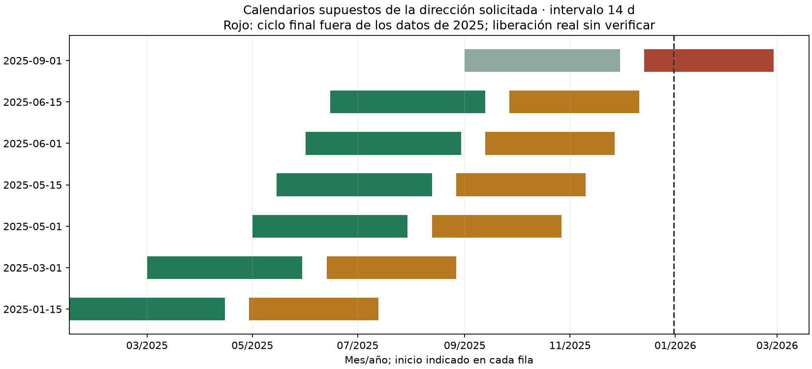
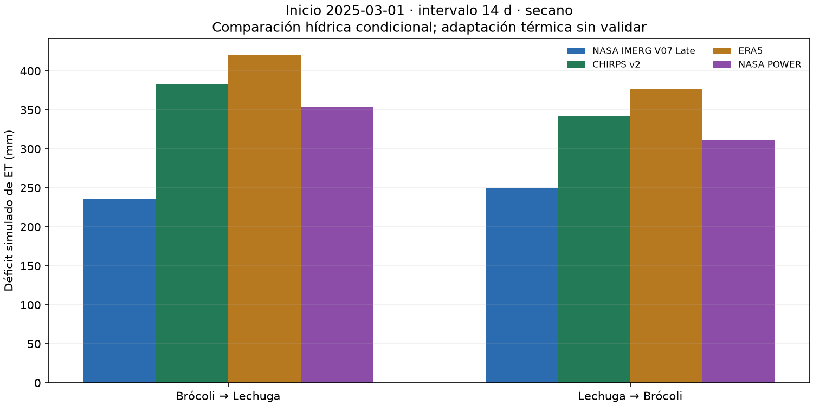
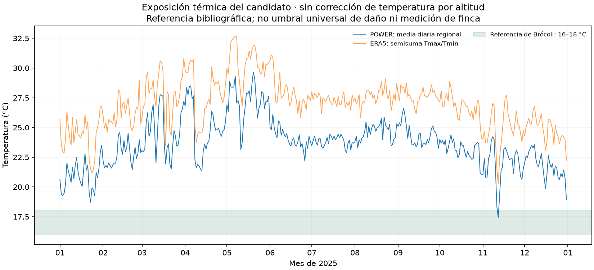

# Auditoría brócoli → lechuga · Chiquimula · 2025

**Fecha:** 15 de noviembre de 2026. Alternativa pendiente de la lista del usuario: **Brócoli → Lechuga**, con **Lechuga → Brócoli** como comparador. Se conserva el candidato **14.8250, −89.5312**, sus datos abiertos de 2025 y el motor hídrico publicado. Es una evaluación retrospectiva exploratoria de calendario, agua y exposición climática; requiere comprobación de finca.

**Dictamen:** El candidato cálido de 373 m presenta una alerta importante de adaptación para brócoli y lechuga. Un resultado favorable en agua no valida formación de una cabeza comercial, ausencia de espigado ni sanidad. La evidencia contextual de brócoli contra Sclerotinia minor no aprueba esta parcela ni demuestra la dirección inversa.

Se evaluaron **252 calendarios**: **170** completos dentro de 2025 y **82** inconclusos, conservados solo como fechas. Los completos generaron **24,480 corridas hídricas** y **12,240 comparaciones pareadas**, incluyendo ambos órdenes. La aprobación térmica, sanitaria, comercial y de rendimiento permanece pendiente.

## Evidencia y parámetros

El [registro de evidencia](fuentes/evidencia_bibliografica.json) declara fuente, localizador, nivel de lectura y límites. El [registro de acceso](fuentes/acceso_documentos.json) conserva descargas, errores y huellas de los documentos consultados.

- **Brócoli y adaptación.** La [ficha primaria MAGA-DIGEGR](https://guatemalanosedetiene.gt/wp-content/uploads/2024/06/FICHA-TECNICA-AGROCLIMATICA-BROCOLI.pdf), alojada en un sitio de terceros con autoría y logotipos institucionales comprobados, describe en página 1 óptimo 16–18 °C y altitud general 1,100–2,500 m. Su zonificación de página 2 usa 1,800–2,300 m y media 15–18 °C. Son criterios diferentes, sin convertirlos en límites absolutos de toda variedad.
- **Producto y fecha de cosecha.** La página 3 de esa ficha distingue **75–90 días después del trasplante** para cabeza principal, ciclo general 90–120 y una figura con laterales/semilla. Se adoptan 75/90 como sensibilidad de la cosecha principal; las etapas se prorratean. Los 135 días de FAO quedan separados como referencia extranjera. La raíz de 30 cm MAGA también difiere de 0.4–0.6 m FAO; se prueban referencia de 0.5 m y límite de 0.3 m, sin escoger una como medición local.
- **Lechuga y calidad.** La [guía original UC IPM](https://ipm.ucanr.edu/home-and-landscape/cultural-tips-for-growing-lettuce/) advierte sobre calor, espigado, amargor y calidad. Su temperatura de inhibición de germinación no se transforma en pérdida de trasplantes. No se traslada el calendario californiano a Guatemala.
- **Evidencia sanitaria favorable con límites.** [Hao, Subbarao y Koike, 2003](https://apsjournals.apsnet.org/doi/pdf/10.1094/PDIS.2003.87.2.159), DOI 10.1094/PDIS.2003.87.2.159, estudió secuencias de varios ciclos en dos sitios de Salinas. El resumen original indexado documenta reducción de *Sclerotinia minor* en el sitio con presión alta. Se consultó el resumen del editor y el registro PubMed; el PDF completo devolvió 403. No se leyó íntegramente ni se extrae una bonificación sanitaria. Una secuencia de varios ciclos no demuestra un efecto universal de una transición o del orden inverso.
- **Alerta coexistente.** Las guías UC IPM de [lechuga](https://ipm.ucanr.edu/agriculture/lettuce/nematodes/) y [coles](https://ipm.ucanr.edu/agriculture/cole-crops/nematodes/) incluyen *Meloidogyne incognita*. Para brócoli es evidencia del grupo de coles, sin susceptibilidad demostrada de cada cultivar. La posible ventaja respecto de un hongo no elimina esta alerta ni demuestra presencia local.

Las identidades y familias se reconsultaron en POWO-Kew, con enlaces en los [parámetros auditados](datos/cultivos/parametros_auditados.json). La familia botánica se usa como descriptor, sin premio o veto de compatibilidad.

| Cultivo | Especie y familia | Kc inicial / medio / final | Raíz de referencia | p | Duraciones |
|---|---|---:|---:|---:|---|
| Brócoli | Brassica oleracea L. (grupo brócoli) · Brassicaceae | 0.70 / 1.05 / 0.95 | 0.50 m | 0.45 | 75, 90, 135 días |
| Lechuga | Lactuca sativa L. · Asteraceae | 0.70 / 1.00 / 0.95 | 0.40 m | 0.30 | 75, 105 días |

Kc y etapas proceden de [FAO-56, tablas 11/12](https://www.fao.org/4/x0490e/x0490e0b.htm); raíces y p de la [tabla 22](https://www.fao.org/4/x0490e/x0490e0e.htm). Los Kc iniciales se heredan del grupo; las raíces son hipótesis escogidas dentro del rango FAO. No se ajustó Kc al clima ni se midieron raíces. El producto es cabeza principal fresca de brócoli y una cosecha de hoja/cabeza de lechuga. No se modelan semillas, laterales prolongados o cortes múltiples. Brócoli: 75/90 días prorrateados como sensibilidades de cosecha principal MAGA; 135 días FAO como escenario extranjero. Lechuga: referencias FAO de 75/105 días. La edad del plantín y la interpretación de las etapas deben validarse con la variedad.

## Sitio, fechas y continuidad

El punto tiene **373 m de elevación DSM** y pendiente local aproximada de 2.6%. SoilGrids estima **130.7 mm de agua disponible en 0–100 cm** y pH superficial aproximado de 7. Se conservan los mismos originales NASA POWER, IMERG V07 Late, CHIRPS v2, ERA5, SoilGrids, MAGA, JAXA y WorldCover de la auditoría anterior. Las API no se consultaron de nuevo. Son estimaciones espaciales, sin delimitación de finca ni medición de temperatura, nutrientes, sanidad o drenaje.

Se conserva la meteorología POWER para ET0 FAO-56, con presión estimada a 373 m. La temperatura regional no se corrige arbitrariamente por altitud. IMERG es Late, no Final. GWET, humedad volumétrica ERA5 y agua disponible simulada no se usan como magnitudes equivalentes.

Se mantienen los inicios del 1/15 de mayo y 1/15 de junio de las auditorías anteriores. Se añaden **15 de enero y 1 de marzo** para estudiar ciclos largos completos y **1 de septiembre** para hacer explícitos calendarios sin cobertura completa. No son ventanas recomendadas. Los intervalos son de 7/14/21 días completos; incluyen retiro, preparación y curado cuando corresponda, sin garantizar que ocurran. El almácigo se supone externo: su tiempo, agua y superficie no se modelan. Si ocupa el mismo sublote, hay que reconstruir el calendario.

| Inicio supuesto | Calendarios completos por dirección |
|---|---:|
| 2025-01-15 | 18 |
| 2025-03-01 | 18 |
| 2025-05-01 | 15 |
| 2025-05-15 | 15 |
| 2025-06-01 | 11 |
| 2025-06-15 | 8 |
| 2025-09-01 | 0 |

Que un ciclo termine antes del 31 de diciembre solo confirma cobertura temporal de los datos. No demuestra madurez comercial, secado/curado o liberación del suelo. Los calendarios que llegan a 2026 no se rellenaron con ceros ni con clima extrapolado.



## Caso de referencia y comparación de agua

Inicio **2025-03-01**, Brócoli 90 días, Lechuga 75 días, intervalo de **14 días completos**. Secano, perfil de referencia, escorrentía supuesta 15%, reserva inicial al 1 de enero 25%.

| Orden | Primer cultivo | Segundo cultivo |
|---|---|---|
| Brócoli → Lechuga | 2025-03-01 a 2025-05-29 | 2025-06-13 a 2025-08-26 |
| Lechuga → Brócoli | 2025-03-01 a 2025-05-14 | 2025-05-29 a 2025-08-26 |

Cada par tiene el mismo inicio, número de días con cultivo, intervalo, fecha final e hipótesis de suelo/agua; cambia el orden y la exposición estacional. No se reinicia el agua al cambiar de cultivo.

| Lluvia | Déficit directo (mm) | Déficit inverso (mm) | Días Ks<0.95 directo/inverso | Riego idealizado directo/inverso (mm netos) |
|---|---:|---:|---:|---:|
| IMERG V07 Late | 236.24 | 249.84 | 96 / 92 | 360 / 420 |
| CHIRPS v2 | 382.88 | 341.94 | 127 / 113 | 460 / 440 |
| ERA5 | 420.32 | 376.23 | 135 / 118 | 500 / 460 |
| POWER | 354.02 | 310.74 | 125 / 116 | 440 / 420 |

Las primeras columnas corresponden a secano. La última corresponde a corridas separadas de riego hipotético: pulsos de 20 mm netos al superar RAW, suministro ilimitado. En la referencia esa regla lleva el déficit a cero; no acredita caudal, eficiencia, calidad de agua, presupuesto ni viabilidad operativa. No es una dosis recomendada.

En la referencia, Brócoli → Lechuga tiene menor déficit con IMERG V07 Late; Lechuga → Brócoli lo tiene con CHIRPS v2, ERA5, POWER. Ningún orden gana con las cuatro fuentes. La coincidencia de una ventaja hídrica en una corrida y una referencia sanitaria favorable no demuestra aptitud térmica ni rendimiento comercial.



En toda la malla de secano hay **6,120 pares**: la inversa acumula mayor déficit en **2,490**, menor en **3,630** y diferencia absoluta de hasta 0.0001 mm en **0**. Son conteos de supuestos diseñados; no son probabilidades de éxito ni frecuencias de campo. No compararlos como un ranking de rentabilidad o rendimiento entre cultivos distintos.

## Exposición térmica y adaptación

Se calculan temperatura durante cada cultivo y exposiciones diarias descriptivas. POWER aporta T2M media diaria; para ERA5 se usa la **semisuma de Tmax/Tmin**, una aproximación diferente de la media diaria. Las máximas se conservan separadas. Ninguno de estos datos es temperatura medida en la planta o el tubérculo.

| Orden y cultivo de referencia | Producto | Temperatura media del período (°C) | Días media>24 °C / total | Días Tmax>30 °C / total |
|---|---|---:|---:|---:|
| Directa · Brócoli | POWER | 25.55 | 64 / 90 | 73 / 90 |
| Directa · Brócoli | ERA5 | 28.65 | 88 / 90 | 81 / 90 |
| Directa · Lechuga | POWER | 24.10 | 37 / 75 | 18 / 75 |
| Directa · Lechuga | ERA5 | 27.42 | 75 / 75 | 71 / 75 |
| Inversa · Lechuga | POWER | 25.12 | 49 / 75 | 58 / 75 |
| Inversa · Lechuga | ERA5 | 28.25 | 73 / 75 | 66 / 75 |
| Inversa · Brócoli | POWER | 24.31 | 52 / 90 | 25 / 90 |
| Inversa · Brócoli | ERA5 | 27.70 | 90 / 90 | 86 / 90 |

Los umbrales 18/20/24/30/35 °C publicados en la tabla de exposiciones permiten examinar las series; no constituyen una función de daño calibrada. Un día con Tmax>30 no equivale a media diaria>30 ni a determinada pérdida de rendimiento. La duración astronómica del día se calcula con la geometría solar FAO-56; no equivale a horas de sol sin nubes.



**El balance hídrico sigue siendo condicional:** temperatura y fotoperíodo no modifican la duración, Kc, crecimiento o rendimiento del cultivo en este motor. Se muestran las alertas para evitar interpretar déficit bajo como adaptación aprobada. No se declara una variedad inviable por un umbral aislado, ni se selecciona el producto térmico más conveniente.

## Método y controles

Por calendario completo se corren **144 combinaciones**: cuatro lluvias × tres hipótesis de suelo/raíces × tres escorrentías (0/15/30%) × dos reservas iniciales (25/75%) × secano/riego. Los casos de suelo son referencia, límite de raíces de **30 cm** y almacenamiento 25% menor. El límite de 30 cm hace visible una profundidad menor que la referencia FAO; son sensibilidades, no tres suelos muestreados.

El balance de cinco capas conserva el agua desde el 1 de enero. Usa Kc único, crecimiento radical por calendario, evaporación de suelo sin cultivo Kc=0.20 y drenaje instantáneo del exceso. No calcula anegamiento, flujo lateral, nivel freático, descomposición de residuos, patógenos, nutrientes, rendimiento o ingresos. El código es el motor del commit `0633f2f2d47562a4860c2904ef23049dd35bd9fa`; el nuevo script añade cultivos, calendarios y exposiciones sin cambiar su contabilidad.

Se procesaron **8,935,200 pasos diarios**; máximo residuo numérico **5.68e-14 mm**. Las **10 pruebas** comprueban parámetros, intervalos, pares, rechazo de ciclos incompletos, conservación sin flujos, ausencia de ET sin agua, drenaje del exceso, geometría solar, distinción media/máxima y reproducción de cuatro lluvias con dos modos de riego del caso previamente publicado. El error pequeño demuestra contabilidad; la exactitud agronómica requiere observaciones de campo.

## Archivos y reproducción

| Archivo | Contenido |
|---|---|
| [configuracion.json](configuracion.json) | Cultivos, fechas, intervalos, escenarios y referencia. |
| [Parámetros](datos/cultivos/parametros_auditados.json) | Producto, taxonomía, Kc, raíces, etapas y supuestos. |
| [Calendarios CSV](resultados/calendarios_evaluados.csv) / [JSON](resultados/calendarios_evaluados.json) | Todos los calendarios, incluidos los inconclusos. |
| [Resultados CSV.gz](resultados/resultados_escenarios.csv.gz) / [JSON.gz](resultados/resultados_escenarios.json.gz) | Todas las corridas; el JSON conserva los segmentos de cada cultivo. |
| [Comparaciones pareadas CSV.gz](resultados/comparacion_pareada.csv.gz) | Diferencia de déficit: inverso menos directo. |
| [Referencia CSV](resultados/comparacion_referencia.csv) / [JSON](resultados/comparacion_referencia.json) | 48 corridas: ambos órdenes, tres intervalos, cuatro lluvias y secano/riego. |
| [Balances diarios CSV.gz](resultados/balances_referencia.csv.gz) | 17,520 filas de las 48 corridas de referencia. |
| [Exposición climática CSV](resultados/exposicion_climatica.csv) | Temperaturas, duración astronómica del día y lluvia por cultivo; solo calendarios completos. |
| [Resumen](resultados/resumen_ejecutivo.json) / [Método](resultados/metodo_y_validacion.json) | Conteos, resultados, límites y hashes de entradas/código. |
| [Evidencia](fuentes/evidencia_bibliografica.json) / [Acceso](fuentes/acceso_documentos.json) | Procedencia y alcance de lectura. Los PDF consultados no se republican. |
| [Control](control_paquete.json) / [Inventario](inventario.json) | Pruebas, integridad, SHA-256 y SHA de objetos Git. |

En el resultado agregado, `P_mm` es la lluvia de todo el año; en cada segmento, `lluvia_mm` corresponde al cultivo. `deficit_ET_mm` acumula ETc−ETa solo durante los cultivos. Ks<0.95 es un indicador del modelo sin traducción validada a daño. Los datos de estas corridas son sintéticos, sin etiquetas observadas de éxito/fracaso para entrenar una red neuronal.

Con Python 3.12, desde esta carpeta:

```sh
python -m venv .venv
# Activar el entorno según el sistema operativo.
python -m pip install -r requirements-simulacion.txt
python scripts/auditar_hortalizas_2025.py
python scripts/verificar_paquete.py
```

La simulación usa los originales incluidos, sin credenciales ni nuevas descargas. `tmp/sim-deps` del workspace se incorpora si existe; en una copia independiente se usan las dependencias fijadas. Las fechas de ejecución y el inventario pueden cambiar. Los scripts de adquisición se conservan como referencia y su ejecución podría descargar revisiones posteriores.

## Antes de recomendar

Confirmar variedad/producto, fechas reales de almácigo/trasplante/cosecha/retiro y disponibilidad del sublote. Medir temperatura y humedad, profundidad física, infiltración y drenaje; hacer análisis de suelo y diagnóstico sanitario dirigido. Verificar agua entregable, trabajo, semilla o plantín sano, manejo de residuos, comprador, calidad y costos. Si se propone otra región más fresca o un sistema protegido, corresponde una nueva parcela y otra auditoría, sin cambiar silenciosamente este punto.
