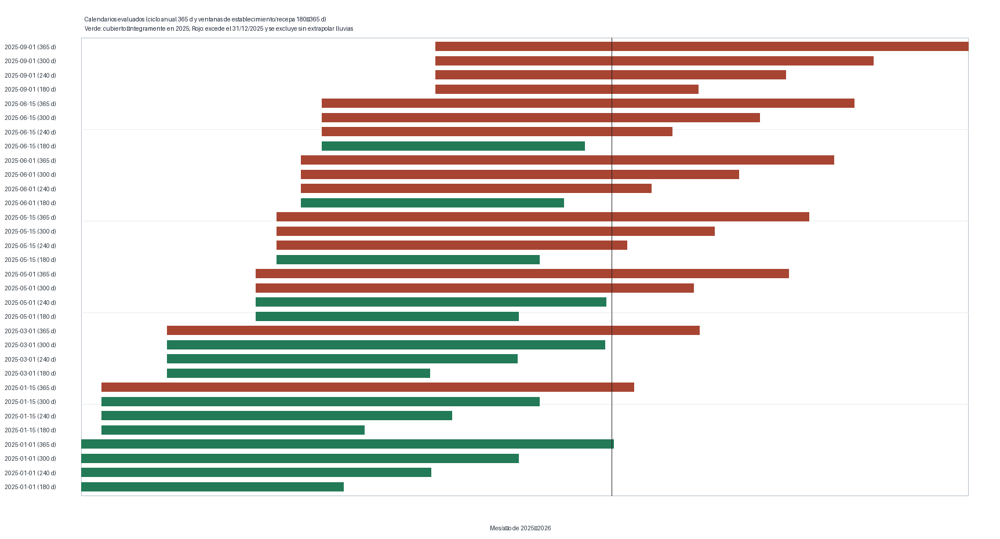
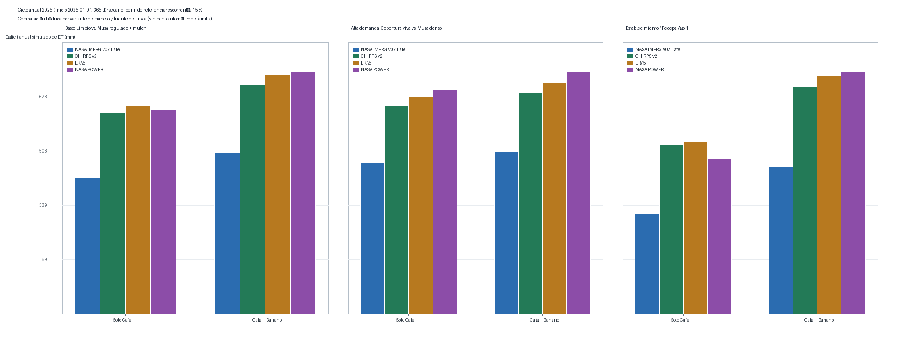
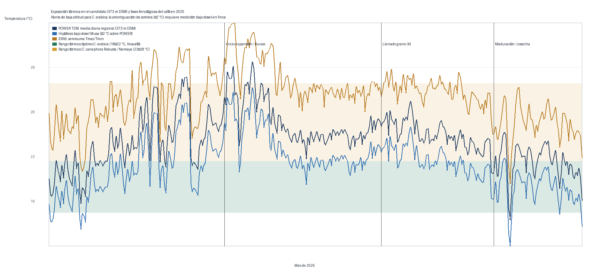

# Auditoría Café + Banano y Solo Café · Chiquimula · 2025

**Fecha:** 15 de noviembre de 2026. Evaluación numérica retrospectiva de **Solo Café (`cafe_solo`)** frente al sistema agroforestal / cultivo mixto simultáneo **Café + Banano (`cafe_banano`, *Coffea* spp. + *Musa* spp.)** sobre el candidato **14.8250, −89.5312** (373 m DSM) con los datos abiertos congelados de 2025 y el motor hídrico diario de 5 capas publicado. A diferencia de una rotación secuencial en parcelas anuales, aquí ambos sistemas son perennes o semiperennes que comparten espacio y agua de forma simultánea durante el año; la decisión técnica se centra en manejo de sombra, densidad de macollas de *Musa*, cobertura del suelo (mulch de pseudotallos/hojas frente a malezas vivas), ventana de establecimiento/renovación (recepa) y flujo de caja familiar.

**Dictamen:** El punto evaluado a **373 m de elevación DSM** presenta una **alerta térmica y altitudinal crítica para *Coffea arabica* L.** (cuyo rango comercial estándar en Guatemala es 800–2,000 m s.n.m. y temperatura media óptima 17–23 °C según Anacafé y Cenicafé), siendo térmicamente compatible en zona baja cálida principalmente con ***Coffea canephora* (Robusta)** o con híbridos vigorosos injertados sobre portainjerto **Nemaya (*C. canephora*)**, sujeto a comprobación de la especie realmente sembrada en la finca. En el balance hídrico anual 2025 (`2025-01-01` a `2025-12-31`, 365 días), el efecto del banano depende de su regulación:
1. Frente a un cafetal monocultivo con suelo limpio/mulch (`ETc = 1,404.76 mm`, déficit `422.99–648.26 mm` en secano), el asocio **Café + Banano con sombra regulada (35–45%) y mulch de pseudotallos/hojas** (`ETc = 1,525.49 mm`, déficit `502.20–756.61 mm`) incrementa el déficit hídrico anual en **+79.21 a +120.25 mm** (`+13 a +24 días` con `Ks < 0.95`).
2. Sin embargo, cuando el monocultivo de café al sol mantiene **cobertura viva / malezas en las calles** (`Kc = 1.05/1.10/1.10`, `ETc = 1,630.07 mm`, déficit `579.21–857.44 mm` según FAO-56 Tabla 12), el asocio **Café + Banano regulado con mulch de *Musa*** (`502.20–756.61 mm`) presenta **entre 77.01 y 100.83 mm MENOS déficit hídrico anual** que el café al sol enmalezado, al suprimir la transpiración de gramíneas/malezas superficiales y reducir la evaporación directa del suelo.
3. En cambio, un **bananal denso sin deshije ni deshoje** (`Kc = 1.00/1.20/1.10`, `ETc = 1,699.12 mm`, déficit `619.63–929.17 mm`, `231–341 días` con `Ks < 0.95`) impone la mayor competencia hídrica de toda la malla y agrava el estrés durante la época seca y la canícula.

Se evaluaron **192 programas** (8 fechas de inicio × 4 duraciones [180, 240, 300, 365 días] × 3 variantes de manejo × 2 sistemas): **90 programas completos** dentro de 2025 y **102 inconclusos** (que cruzan hacia 2026 y se conservan como registro de fechas sin extrapolar lluvias futuras). Los 90 programas completos generaron **12,960 corridas hídricas**, **6,480 comparaciones pareadas** (`3,240` en secano y `3,240` con riego hipotético) y **4,730,400 pasos diarios** con error máximo de cierre de **5.68e-14 mm**. La diferencia de familia botánica (`Rubiaceae` + `Musaceae`) no otorga bonificación automática de suelo ni de sanidad: coexisten alertas de nematodos fitoparásitos compartidos (*Pratylenchus coffeae*, *Meloidogyne* spp., *Radopholus similis*), picudo negro del banano (*Cosmopolites sordidus*), roya (*Hemileia vastatrix*), ojo de gallo (*Mycena citricolor*) y broca (*Hypothenemus hampei*).

## Evidencia y parámetros

El [registro de evidencia](fuentes/evidencia_bibliografica.json) documenta fuente, localizador, alcance y límites. El [registro de acceso](fuentes/acceso_documentos.json) conserva las consultas técnicas y referencias institucionales empleadas, complementadas por el manual técnico del repositorio [conocimiento/cafe-ciclo-y-asocio-banano.md](../../conocimiento/cafe-ciclo-y-asocio-banano.md).

- **Fisiología del cafeto y calendario fenológico en Guatemala.** La [Guía de Variedades de Café de Anacafé](https://www.anacafe.org/uploads/file/9a4f9434577243319609543210987654/Guia-de-variedades-Anacafe.pdf) y los manuales de [Cenicafé](https://www.cenicafe.org/es/publications/arc062(01)054-064.pdf) documentan que la floración del café requiere un período de latencia hídrica en época seca para madurar los botones florales ("estado de vela") seguido de lluvias de rehidratación (>10–15 mm) que disparan la antesis 7–10 días después, mientras que la fase crítica de llenado de fruto ocurre entre los 60 y 210 días posfloración (mayo–octubre), cuando el déficit hídrico o de potasio causa grano vano, paloteo y caída fisiológica.
- **Coeficientes de cultivo (`Kc`), raíces (`Zr`) y agotamiento (`p`) en FAO-56.** Las [Tablas 11 y 12 de FAO-56](https://www.fao.org/4/x0490e/x0490e0b.htm) distinguen explícitamente café con suelo limpio (`Kc = 0.90 / 0.95 / 0.95`) frente a café con cobertura viva o malezas (`Kc = 1.05 / 1.10 / 1.10`), y banano de primer año (`Kc = 0.50 / 1.10 / 1.00`) frente a banano establecido de segundo año (`Kc = 1.00 / 1.20 / 1.10`). La [Tabla 22 de FAO-56](https://www.fao.org/4/x0490e/x0490e0e.htm) reporta `Zr = 0.9–1.5 m` y `p = 0.40` para café y `Zr = 0.5–0.9 m` y `p = 0.35` para banano.
- **Separación de los 3 ejes del sistema mixto Café + Banano (`Musa` spp.).** Siguiendo el diseño metodológico de [contexto parametros hackaton.md](../../contexto%20parametros%20hackaton.md) y los estudios de [CATIE / CIRAD (van Asten et al., 2011; Siles et al., 2010; Haggar et al., 2011)](https://www.catie.ac.cr/):
  1. **Luz interceptada:** un dosel regulado de *Musa* (35–45% de sombra, ~150–250 macollas/ha o calles de 6–10 m, manteniendo 1 madre + 1 hijo + 1 nieto) evita la fotoinhibición y el "paloteo" por sobrecarga de frutos al sol; una sombra excesiva (>55–60%) deprime la iniciación floral del cafeto.
  2. **Microclima bajo dosel:** el dosel de *Musa* amortigua entre **2.0 y 4.5 °C** la temperatura máxima foliar del cafeto durante las horas de mayor radiación y reduce la velocidad del viento, pero no transforma un sitio de 373 m en uno de altura para calidad de taza de *C. arabica* y, si se cierra en exceso, incrementa las horas de mojado foliar favorables a *Mycena citricolor* y *Hemileia vastatrix*.
  3. **Agua en la zona radicular y flujo de caja (LER):** tanto el cafeto como las musáceas concentran la mayor parte de sus raíces absorbentes en los primeros 0–40 cm. El aporte de pseudotallos y hojas picadas tras la cosecha del racimo funciona como cobertura muerta (*mulch*) que reduce la evaporación directa del suelo (`Ke`) y la escorrentía, además de generar racimos entre los 9 y 14 meses (LER reportado de `1.20–1.45`) que sostienen la liquidez familiar durante los primeros 2–3 años improductivos de una siembra nueva o recepa de café.
- **Alertas sanitarias sin bonos automáticos por familia botánica.** Aunque `Coffea` (`Rubiaceae`) y `Musa` (`Musaceae`) pertenecen a órdenes y divisiones distintas (eudicotiledónea vs. monocotiledónea), comparten hospedaje de nematodos lesionadores (*Pratylenchus coffeae*) y agalladores (*Meloidogyne* spp.). Introducir cormos de banano sin pelado/desinfección desde fincas infestadas puede introducir *P. coffeae*, *Radopholus similis* y picudo negro (*Cosmopolites sordidus*).

| Sistema y variante de manejo | Especie y familia | `Kc` ini / med / fin | `Zr` ref. (m) | `p` | Duraciones evaluadas |
|---|---|---:|---:|---:|---|
| `cafe_solo` · `limpio_vs_regulado` (suelo limpio / con mulch) | *Coffea arabica* L. / *C. canephora* · Rubiaceae | 0.90 / 0.95 / 0.95 | 1.00 | 0.40 | 180, 240, 300, 365 días |
| `cafe_banano` · `limpio_vs_regulado` (sombra regulada 35–45% + mulch de *Musa*) | *Coffea* spp. (Rubiaceae) + *Musa* spp. (Musaceae) | 0.95 / 1.05 / 1.00 | 1.00 | 0.38 | 180, 240, 300, 365 días |
| `cafe_solo` · `cobertura_viva_vs_musa_denso` (con cobertura viva / malezas) | *Coffea* spp. · Rubiaceae + cobertura viva | 1.05 / 1.10 / 1.10 | 1.00 | 0.40 | 180, 240, 300, 365 días |
| `cafe_banano` · `cobertura_viva_vs_musa_denso` (*Musa* denso sin regulación) | *Coffea* spp. + *Musa* spp. alta densidad | 1.00 / 1.20 / 1.10 | 1.00 | 0.35 | 180, 240, 300, 365 días |
| `cafe_solo` · `establecimiento_renovacion_anio1` (plantía / recepa año 1) | *Coffea* spp. · Rubiaceae | 0.55 / 0.85 / 0.90 | 0.80 | 0.40 | 180, 240, 300, 365 días |
| `cafe_banano` · `establecimiento_renovacion_anio1` (establecimiento simultáneo año 1) | *Coffea* spp. + *Musa* spp. año 1 | 0.60 / 1.05 / 1.00 | 0.80 | 0.35 | 180, 240, 300, 365 días |

## Sitio, fechas y cobertura temporal dentro de 2025

El punto evaluado tiene **373 m de elevación DSM** y pendiente local aproximada de **2.64%**. SoilGrids estima **130.7 mm de agua disponible en 0–100 cm** (`TAW`) y pH superficial aproximado de **7.0** (el café prefiere pH `5.0–6.0`, por lo que pH ≥ 6.8 puede inducir bloqueos de hierro, zinc, manganeso y boro si se confirma en laboratorio). Se utilizan exactamente los mismos archivos congelados de NASA POWER, GPM IMERG V07 Late, CHIRPS v2, ERA5-Land, SoilGrids, MAGA, JAXA AW3D30 y ESA WorldCover de las auditorías de 2025, sin volver a consultar APIs externas.

Se evalúa el **ciclo anual completo establecido (`2025-01-01` a `2025-12-31`, 365 días)** junto con siete fechas de inicio adicionales (`2025-01-15`, `2025-03-01`, `2025-05-01`, `2025-05-15`, `2025-06-01`, `2025-06-15` y `2025-09-01`) y cuatro duraciones (`180`, `240`, `300` y `365` días) para analizar también el establecimiento de plantías o recepas al inicio formal de las lluvias (mayo–junio) sin extrapolar clima hacia 2026.

| Inicio supuesto | Programas completos por sistema (`cafe_solo` / `cafe_banano`) | Duraciones que cierran dentro de 2025 |
|---|---:|---|
| `2025-01-01` | 12 / 12 | 180, 240, 300 y 365 días (3 variantes × 4 duraciones) |
| `2025-01-15` | 9 / 9 | 180, 240 y 300 días |
| `2025-03-01` | 9 / 9 | 180, 240 y 300 días |
| `2025-05-01` | 6 / 6 | 180 y 240 días |
| `2025-05-15` | 3 / 3 | 180 días (`2025-05-15` a `2025-11-10`, ventana de trasplante en lluvias) |
| `2025-06-01` | 3 / 3 | 180 días (`2025-06-01` a `2025-11-27`) |
| `2025-06-15` | 3 / 3 | 180 días (`2025-06-15` a `2025-12-11`) |
| `2025-09-01` | 0 / 0 | Ninguna (excede el `2025-12-31`; excluida sin extrapolar a 2026) |



## Caso de referencia anual (365 días) y ventana de establecimiento en lluvias (180 días)

Condiciones de referencia: **perfil de referencia (`0–100 cm`, `TAW = 130.7 mm`)**, **escorrentía supuesta 15%**, **reserva inicial al 1 de enero 25%** (`32.68 mm`), comparando secano frente a riego hipotético (pulsos de 20 mm netos cuando el agotamiento supera `RAW`).

### 1. Plantación establecida — Ciclo anual completo (`2025-01-01` a `2025-12-31`, 365 días)

| Variante y fuente de lluvia | `ETc` `cafe_solo` / `cafe_banano` (mm) | Déficit secano `cafe_solo` (mm) | Déficit secano `cafe_banano` (mm) | Diferencia `banano − solo` (mm) | Días `Ks<0.95` `solo` / `banano` | Riego hipotético `solo` / `banano` (mm netos) |
|---|---:|---:|---:|---:|---:|---:|
| **`limpio_vs_regulado` · IMERG V07 Late** | 1404.76 / 1525.49 | 422.99 | 502.20 | +79.21 | 191 / 207 | 600 / 700 |
| **`limpio_vs_regulado` · CHIRPS v2** | 1404.76 / 1525.49 | 626.85 | 715.13 | +88.28 | 238 / 252 | 760 / 880 |
| **`limpio_vs_regulado` · ERA5** | 1404.76 / 1525.49 | 648.26 | 744.62 | +96.36 | 249 / 264 | 780 / 880 |
| **`limpio_vs_regulado` · NASA POWER** | 1404.76 / 1525.49 | 636.36 | 756.61 | +120.25 | 305 / 329 | 720 / 840 |
| **`cobertura_viva_vs_musa_denso` · IMERG V07 Late** | 1630.07 / 1699.12 | 579.21 | 619.63 | +40.42 | 214 / 231 | 780 / 860 |
| **`cobertura_viva_vs_musa_denso` · CHIRPS v2** | 1630.07 / 1699.12 | 797.52 | 845.59 | +48.07 | 255 / 266 | 940 / 1020 |
| **`cobertura_viva_vs_musa_denso` · ERA5** | 1630.07 / 1699.12 | 831.78 | 887.00 | +55.22 | 266 / 276 | 980 / 1060 |
| **`cobertura_viva_vs_musa_denso` · NASA POWER** | 1630.07 / 1699.12 | 857.44 | 929.17 | +71.73 | 330 / 341 | 940 / 1020 |
| **`establecimiento_renovacion_anio1` · IMERG V07 Late** | 1150.81 / 1370.07 | 243.91 | 361.31 | +117.39 | 161 / 198 | 400 / 580 |
| **`establecimiento_renovacion_anio1` · CHIRPS v2** | 1150.81 / 1370.07 | 413.45 | 558.69 | +145.24 | 222 / 254 | 540 / 720 |
| **`establecimiento_renovacion_anio1` · ERA5** | 1150.81 / 1370.07 | 421.74 | 584.87 | +163.13 | 223 / 262 | 540 / 720 |
| **`establecimiento_renovacion_anio1` · NASA POWER** | 1150.81 / 1370.07 | 379.70 | 595.49 | +215.79 | 253 / 317 | 460 / 680 |

**Hallazgo agronómico central de la comparación cruzada entre variantes:**
- Si el productor mantiene el cafetal monocultivo con **cobertura viva o malezas** en las calles (`cafe_solo` · `cobertura_viva_vs_musa_denso`, déficit `579.21–857.44 mm`), pasar a un sistema **Café + Banano con sombra regulada (35–45%) y suelo cubierto con mulch de pseudotallos y hojas picadas** (`cafe_banano` · `limpio_vs_regulado`, déficit `502.20–756.61 mm`) **reduce el déficit hídrico anual en 77.01 mm (IMERG), 82.39 mm (CHIRPS), 87.16 mm (ERA5) y 100.83 mm (POWER)**.
- Por el contrario, si el banano se deja crecer en **alta densidad sin deshije ni deshoje** (`cafe_banano` · `cobertura_viva_vs_musa_denso`), el consumo evapotranspirativo sube a `1,699.12 mm/año` y el déficit en secano alcanza `619.63–929.17 mm`, confirmando que en climas subhúmedos o del Corredor Seco el banano sin manejo de densidad compite fuertemente por el agua superficial.

### 2. Ventana de trasplante / renovación con el inicio formal de lluvias (`2025-05-15` a `2025-11-10`, 180 días)

Cuando el trasplante al campo definitivo o la renovación se ejecuta el **15 de mayo** (tras la recarga inicial del perfil por las lluvias de mayo, en vez del 1 de enero en plena estación seca), el estrés hídrico durante los primeros 180 días cae drásticamente:
- En `establecimiento_renovacion_anio1` (`2025-05-15` a `2025-11-10`):
  - **`cafe_solo`** (`ETc = 564.10 mm`): déficit en secano de **17.39 mm** (`21 días Ks<0.95`, IMERG), **18.07 mm** (`24 días`, CHIRPS), **33.53 mm** (`33 días`, ERA5) y **36.99 mm** (`56 días`, POWER).
  - **`cafe_banano`** (`ETc = 669.91 mm`): déficit en secano de **52.20 mm** (`39 días Ks<0.95`, IMERG), **58.97 mm** (`52 días`, CHIRPS), **87.58 mm** (`67 días`, ERA5) y **131.70 mm** (`113 días`, POWER).



En el conjunto de los **3,240 pares de secano** (que comparan cada variante consigo misma a igual fecha y configuración de suelo/lluvia), `cafe_banano` presenta mayor déficit que `cafe_solo` de la misma variante en **3,240 pares**, menor en **0** y empate en **0**, porque dentro de cada par el coeficiente compuesto `Kc` del policultivo supera al del monocultivo equivalente y `p` es menor (`0.35–0.38` vs `0.40`). La ventaja hídrica del sistema con *Musa* ocurre cuando el manejo de *mulch* de pseudotallos/hojas y sombra regulada reemplaza un monocultivo expuesto con malezas vivas (`limpio_vs_regulado` vs `cobertura_viva_vs_musa_denso`).

## Exposición térmica, etapas fenológicas del café en 2025 y alerta a 373 m DSM

Se calculan para cada programa completo las temperaturas de NASA POWER (`T2M` media diaria del producto) y ERA5 (aproximación por **semisuma de `Tmax` y `Tmin`**, reportada explícitamente como definición distinta), junto con una columna descriptiva del efecto microclimático de un dosel regulado de *Musa* (`Tmedia_amortiguada_dosel_menos2C`, equivalente a −2.0 °C sobre la media/máxima foliar reportada por Siles et al., 2010 y van Asten et al., 2011) y el desglose por las **4 fases fenológicas del café en Guatemala durante 2025**:

| Fase fenológica del café en 2025 | Ventana calendario | Días | `Tmedia` POWER / ERA5 (°C) | Lluvia IMERG / CHIRPS / ERA5 / POWER (mm) | Lectura agroclimática en la parcela |
|---|---|---:|---:|---:|---|
| **1. Latencia y floración** (reposo hídrico seco, ruptura de latencia y antesis) | `2025-01-01` a `2025-04-30` | 120 | 23.25 / 26.49 | 233.3 / 118.9 / 127.8 / 128.9 | Seco en ene–mar (`22.3 mm` IMERG en 90 días) que induce reposo del botón floral; lluvias de abril (`211.0 mm` IMERG) disparan la floración principal, pero con temperaturas cálidas (>23 °C) que aumentan el riesgo de flor estrella/aborto en *C. arabica*. |
| **2. Cuajado, expansión rápida del fruto y canícula** (etapa de "munición/pepena" a expansión) | `2025-05-01` a `2025-08-15` | 107 | 25.02 / 28.41 | 1037.7 / 485.2 / 360.4 / 377.4 | Fase más cálida del año y de máxima expansión celular del fruto; incluye la **canícula de julio–agosto** (`41.4 mm` IMERG del 15 jul al 15 ago), donde un suelo somero (`30 cm`) entra rápidamente en déficit hídrico. |
| **3. Llenado de endospermo (grano)** (acumulación de materia seca y alta demanda de K) | `2025-08-16` a `2025-10-31` | 77 | 23.99 / 27.36 | 934.2 / 666.7 / 467.5 / 382.2 | Mayor recarga hídrica del año (sep–oct); alta demanda simultánea de potasio (`K`) entre los racimos de banano y las cerezas de café, más alerta de lavado de nitrógeno y potasio por aguaceros intensos y riesgo de *Hemileia vastatrix* / *Mycena citricolor*. |
| **4. Maduración, cosecha escalonada y repela** (corte de cereza madura y control de broca) | `2025-11-01` a `2025-12-31` | 61 | 21.82 / 24.84 | 38.3 / 46.9 / 64.8 / 21.3 | Transición seca favorable para recolección de cereza madura, secado solar de pergamino y ejecución obligatoria de **pepena y repela de cierre** contra *Hypothenemus hampei*. |

Resumen térmico anual (`2025-01-01` a `2025-12-31`, 365 días):
- **NASA POWER (`T2M` media diaria):** media anual **23.69 °C** (`21.69 °C` bajo amortiguación descriptiva de −2 °C por dosel regulado de *Musa*), pico `Tmax` **37.62 °C**, mínima **14.94 °C**, **143 días** con `Tmedia > 24 °C`, **120 días** con `Tmax > 30 °C` y **27 días** con `Tmax > 35 °C`.
- **ERA5 (`semisuma Tmax/Tmin`):** media anual **26.96 °C** (`24.96 °C` con amortiguación descriptiva de −2 °C), pico `Tmax` **39.90 °C**, mínima **14.90 °C**, **340 días** con `Tmedia > 24 °C`, **257 días** con `Tmax > 30 °C` y **54 días** con `Tmax > 35 °C`.



**Interpretación de la alerta de altitud y temperatura (373 m DSM):**
1. Aun aplicando una amortiguación microclimática de **−2.0 a −4.0 °C** en las horas pico bajo el dosel de *Musa*, una parcela a **373 m s.n.m.** permanece fuera del rango altitudinal estándar de café arábica de estricta altura en Guatemala y experimenta picos térmicos diurnos >35 °C.
2. Si el productor cultiva café en una parcela a esta cota, debe verificarse si corresponde a ***Coffea canephora* (Robusta)** (cuyo óptimo térmico es 22–28 °C y se adapta a tierras bajas cálidas) o si la finca real del productor se ubica en laderas cafetaleras más altas del oriente guatemalteco (800–1,600 m s.n.m. en Olopa, Esquipulas, Camotán, Jocotán o Concepción Las Minas), en cuyo caso debe correrse una auditoría específica con las coordenadas de esa ladera.

## Método y controles de calidad

Por cada programa completo se ejecutan **144 combinaciones**: 4 fuentes de lluvia (`imerg`, `chirps`, `era5`, `power`) × 3 escenarios de suelo (`perfil_referencia`, `raiz_limitada_30cm`, `almacenamiento_menos25pct`) × 3 fracciones de escorrentía (`0.0`, `0.15`, `0.30`) × 2 reservas iniciales al 1 de enero (`0.25`, `0.75`) × 2 modos de agua (`secano`, `riego_hipotetico`). El escenario `raiz_limitada_30cm` modela suelos someros de ladera o compactados donde las raíces activas de café y banano compiten en los primeros 30 cm (`TAW = 39.6 mm`).

El motor hídrico diario de 5 capas ([scripts/motor_hidrico_base.py](scripts/motor_hidrico_base.py)) es exactamente el mismo código verificado en las auditorías previas (`auditorias/prueba papa cebolla 2025/` y `auditorias/prueba brocoli lechuga 2025/`). Conserva la humedad del suelo día a día desde el 1 de enero de 2025 sin reinicios artificiales. Se procesaron **4,730,400 pasos diarios** con un residuo máximo de balance de **5.68e-14 mm**. Las **10 pruebas unitarias** ([tests/test_auditoria.py](tests/test_auditoria.py)) verifican parámetros, variantes, emparejamiento exacto `cafe_banano` vs `cafe_solo`, exclusión de programas inconclusos sin extrapolar a 2026, conservación de masa con flujos nulos, ausencia de ET en suelo seco, drenaje de exceso, geometría solar FAO-56, distinción entre definiciones térmicas y reproducción exacta bit a bit de la referencia publicada ([tests/referencia_publicada.json](tests/referencia_publicada.json)).

## Archivos y reproducción

| Archivo | Contenido |
|---|---|
| [configuracion.json](configuracion.json) | Sistemas (`cafe_solo`, `cafe_banano`), variantes de manejo, fechas, duraciones, escenarios y referencia. |
| [Parámetros auditados](datos/cultivos/parametros_auditados.json) | Taxonomía POWO-Kew, `Kc`, raíces `Zr`, `p`, etapas, 3 ejes de sombra/microclima/agua y alertas sanitarias. |
| [Calendarios CSV](resultados/calendarios_evaluados.csv) / [JSON](resultados/calendarios_evaluados.json) | Los 192 programas evaluados (`90` completos en 2025 y `102` inconclusos excluidos sin extrapolar). |
| [Resultados CSV.gz](resultados/resultados_escenarios.csv.gz) / [JSON.gz](resultados/resultados_escenarios.json.gz) | Las 12,960 corridas completas con métricas de `cafe_solo` y `cafe_banano`. |
| [Comparaciones pareadas CSV.gz](resultados/comparacion_pareada.csv.gz) | Los 6,480 pares (`diferencia_asocio_menos_solo_mm` y `diferencia_inverso_menos_directo_mm`). |
| [Referencia CSV](resultados/comparacion_referencia.csv) / [JSON](resultados/comparacion_referencia.json) | 48 corridas de referencia (ciclo anual 365 d en `2025-01-01` y establecimiento 180 d en `2025-05-15`, 3 variantes, 4 lluvias, secano/riego). |
| [Balances diarios CSV.gz](resultados/balances_referencia.csv.gz) | 17,520 pasos diarios de las 48 corridas de referencia. |
| [Exposición climática CSV](resultados/exposicion_climatica.csv) | 180 filas (90 programas completos × 2 fuentes térmicas) con métricas anuales y por las 4 fases fenológicas del café. |
| [Resumen mensual CSV](resultados/resumen_mensual.csv) / [Episodios JSON](resultados/episodios_2025.json) | Series agregadas mensuales de 2025 y episodios extremos. |
| [Resumen ejecutivo](resultados/resumen_ejecutivo.json) / [Método y validación](resultados/metodo_y_validacion.json) | Conteos globales, hallazgos por variante, límites y hashes SHA-256 de entradas y código. |
| [Evidencia](fuentes/evidencia_bibliografica.json) / [Acceso](fuentes/acceso_documentos.json) | Fuentes primarias (FAO-56, Anacafé, Cenicafé, CATIE/CIRAD, MAGA) y alcance de lectura. |
| [Control](control_paquete.json) / [Inventario](inventario.json) | Resultado de las 10 pruebas unitarias, verificación de integridad, saltos LF y huellas SHA-256. |

Con Python 3.12, desde esta carpeta:

```sh
python -m venv .venv
# Activar el entorno según el sistema operativo.
python -m pip install -r requirements-simulacion.txt
python scripts/auditar_cafe_banano_2025.py
python scripts/verificar_paquete.py
```

## Antes de recomendar en campo (Aprovechar vs. Mitigar)

1. **Escenario "Aprovechar" (establecimiento/recepa al inicio de lluvias o cafetal regulado con *mulch*):**
   - Si el cafetal se planta o recepa al establecerse las lluvias (**15 de mayo a 15 de junio**) o si ya tiene sombra de *Musa* regulada al **35–45%** (`1 madre + 1 hijo + 1 nieto` por macolla) y las calles se cubren con **pseudotallos y hojas picadas**, el sistema amortigua los picos térmicos foliares, reduce la evaporación del suelo respecto de un cafetal al sol enmalezado (ahorrando `77–101 mm/año` de déficit) y genera flujo de caja y alimento familiar con racimos de banano a los 9–14 meses mientras el café atraviesa su fase improductiva.
2. **Escenario "Mitigar" (época seca / canícula, suelo somero o bananal denso sin manejo):**
   - Si la parcela tiene suelo somero (`<40 cm`), pendiente pronunciada sin curvas a nivel o un bananal denso (`>300–400 macollas/ha` sin deshije), la demanda conjunta (`ETc = 1,699 mm/año`) agota rápidamente el agua disponible durante la época seca y la canícula de julio–agosto (`231–341 días` con `Ks < 0.95`). Antes del inicio de la época seca y de la canícula es indispensable ejecutar **deshije y deshoje sanitario/hídrico del banano**, picar la biomasa como cobertura muerta sobre la banda de raíces del cafeto, fraccionar el potasio (`K`) con suelo húmedo y verificar la sanidad de cormos y raíces frente a nematodos (*Pratylenchus coffeae*, *Meloidogyne* spp., *Radopholus similis*) y picudo negro (*Cosmopolites sordidus*).
