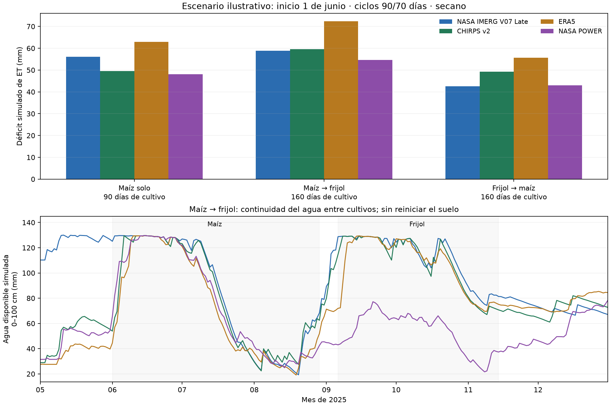

# Prueba frijol–maíz · Chiquimula · 2025

Reconstrucción agroclimática y comparación hídrica exploratoria preparada el **14 de noviembre de 2026** para Field Shift Guatemala. Esta carpeta reúne los archivos de la prueba en el candidato agrícola **14.8250, −89.5312**, elegido por el usuario en el chat.

**Alcance:** series de 2025 y 1,728 combinaciones de supuestos para maíz solo, maíz→frijol y frijol→maíz. Es un ejercicio de agua y calendario, sin validación de campo, diagnóstico sanitario, predicción de rendimiento o entrenamiento de una red neuronal.

## Por dónde empezar

1. Leer el [informe completo](investigacion/escenarios-chiquimula-2025/README.md), con métodos, fuentes, resultados y limitaciones.
2. Consultar el [entorno diario de 2025](datos/escenarios/chiquimula_2025/entorno_diario_2025.csv) y el [sitio y perfil de suelo](datos/escenarios/chiquimula_2025/sitio_y_suelo.json).
3. Comparar los [casos de referencia](investigacion/escenarios-chiquimula-2025/comparacion_referencia.csv) o explorar los [1,728 resultados](investigacion/escenarios-chiquimula-2025/resultados_escenarios.csv).
4. Revisar [supuestos, versiones y hashes de las fuentes](investigacion/escenarios-chiquimula-2025/metodo_y_validacion.json) y el [inventario del paquete](inventario.json).

## Resultados principales

- NASA POWER identifica el **14–27 de mayo** como la ventana de 14 días con mayor promedio de temperatura máxima: **34.3 °C**.
- IMERG y CHIRPS coinciden en una racha de **11 días con menos de 1 mm diario, del 15 al 25 de julio**, y en la semana de mayor lluvia, **17–23 de septiembre**. Estos son episodios calculados en las series, sin declaración oficial de desastre o canícula.
- Las estimaciones anuales de lluvia difieren: **2,243.5 mm IMERG V07 Late**, **1,317.7 mm CHIRPS v2**, **1,020.5 mm ERA5** y **909.8 mm POWER**. No se eligió una como verdad de la parcela sin estación local.
- Para el calendario ilustrativo desde el **1 de junio**, ciclos de **90/70 días**, perfil de referencia y secano, **frijol→maíz mostró menor déficit hídrico que maíz→frijol con las cuatro fuentes de lluvia**. El resultado depende de esos supuestos y no aprueba una rotación real.



## Contenido

| Ruta | Contenido |
|---|---|
| `datos/escenarios/chiquimula_2025/` | Respuestas originales POWER, IMERG, CHIRPS y ERA5; datos diarios integrados; perfil de suelo; solicitudes, fechas y procedencia. |
| `datos/escenarios/chiquimula_2025/suelo_wcs/` | 21 recortes TIFF de SoilGrids y registro de descarga. |
| `datos/relieve/`, `datos/cobertura/`, `datos/maga/` | Archivos espaciales utilizados, conservados para reproducir la extracción del punto. Las capas del MAGA mantienen su alcance cartográfico y la nota sobre redistribución del proyecto. |
| `datos/cultivos/` | Parámetros de referencia de maíz/frijol y copia documental de la matriz de compatibilidad. La matriz no es una etiqueta de éxito del simulador. |
| `investigacion/escenarios-chiquimula-2025/` | Informe, tres gráficas, episodios, resumen mensual, resultados por escenario y balances diarios de 24 casos de referencia. |
| `scripts/` | Descarga y simulación reproducibles. |
| `tests/` | Cuatro pruebas de límites físicos del balance. |
| `requirements-simulacion.txt` | Dependencias Python de la corrida comprobada. |
| `control_paquete.json`, `inventario.json` | Comprobaciones y huellas de los archivos publicados; el inventario excluye su propia huella. |

## Fuentes y límites

Se usaron [NASA POWER](https://power.larc.nasa.gov/docs/services/api/temporal/daily/), [NASA IMERG](https://gpm.nasa.gov/data/imerg) **V07 Late**, [CHIRPS v2 de UCSB](https://www.chc.ucsb.edu/data/chirps) mediante [ClimateSERV](https://climateserv2.servirglobal.net/develop-api), [ERA5 vía Open-Meteo](https://open-meteo.com/en/docs/historical-weather-api), [SoilGrids de ISRIC](https://docs.isric.org/globaldata/soilgrids/SoilGrids_faqs_02.html), [FAO-56](https://www.fao.org/4/x0490e/x0490e00.htm) y los archivos espaciales ya presentes en el repositorio. La localización procede del candidato D01 de [decisions.md](../../proyecto/decisions.md).

IMERG **Late no equivale a Final**. GWET de POWER es saturación regional adimensional; la humedad ERA5 es volumétrica modelada. Ninguna constituye una medición de la finca. SoilGrids es estático y tampoco representa un análisis de suelo de 2025.

Los 90/70 días representan ciclos y retiros **supuestos**; no garantizan grano seco ni liberación del terreno. Si el maíz sigue en pie al establecer el frijol, debe analizarse como relevo. Faltan verificar variedad, sanidad, drenaje, profundidad física, retiro real y agua entregable. El modelo conserva el agua entre cultivos y no convierte el cambio de familia en un beneficio automático.

Las rutas de contexto que aparecen dentro de la copia de `compatibilidad_sucesiones.json` identifican documentos del proyecto original; ese archivo no interviene en el cálculo del balance. Los datos numéricos originales se conservan; los textos de esta copia usan finales de línea LF para su publicación. Los hashes del método corresponden a las copias incluidas aquí.

## Repetir la prueba

La carpeta contiene los datos necesarios: **no hace falta volver a descargarlos** para repetir el cálculo. En PowerShell, desde la raíz del repositorio:

```powershell
Set-Location -LiteralPath 'auditorias/prueba frijol maiz 2025'
python -m venv .venv
.\.venv\Scripts\python.exe -m pip install -r requirements-simulacion.txt
.\.venv\Scripts\python.exe scripts/simular_chiquimula_2025.py
.\.venv\Scripts\python.exe -m unittest discover -s tests -v
```

Para obtener nuevamente las fuentes públicas, los scripts Node.js usan las coordenadas de este caso y conservan archivos existentes como caché:

```powershell
node scripts/descargar_escenario_chiquimula_2025.cjs
node scripts/descargar_escenario_chiquimula_2025.cjs --poll
node scripts/descargar_suelo_escenario_2025.cjs
```

`--poll` consulta las solicitudes asíncronas de ClimateSERV. El balance solo se debe ejecutar cuando las cuatro series estén completas. Una descarga futura puede contener revisiones del proveedor; las respuestas incluidas fijan la versión de esta prueba.

## Verificación

Se reprodujo el cálculo dentro de esta carpeta y se comprobaron los límites físicos mediante las cuatro pruebas. Se revisaron fechas, fuentes, enlaces e inventario. El control de conservación cubre **630,720 pasos diarios**, con error de cierre menor de **10⁻⁷ mm**. Estas comprobaciones validan integridad y contabilidad del agua; no validan el modelo contra observaciones de campo.
