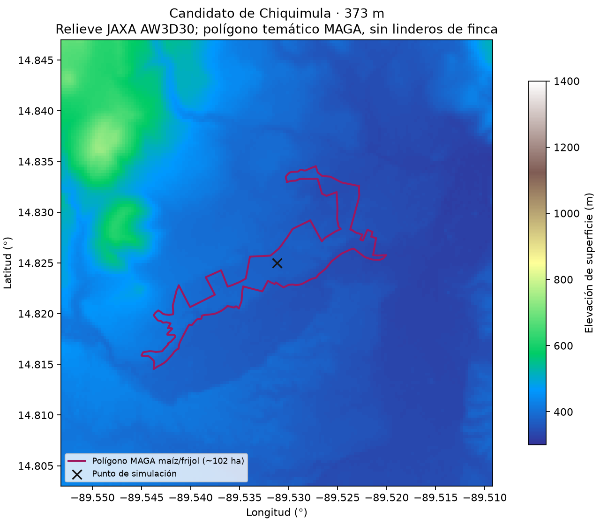
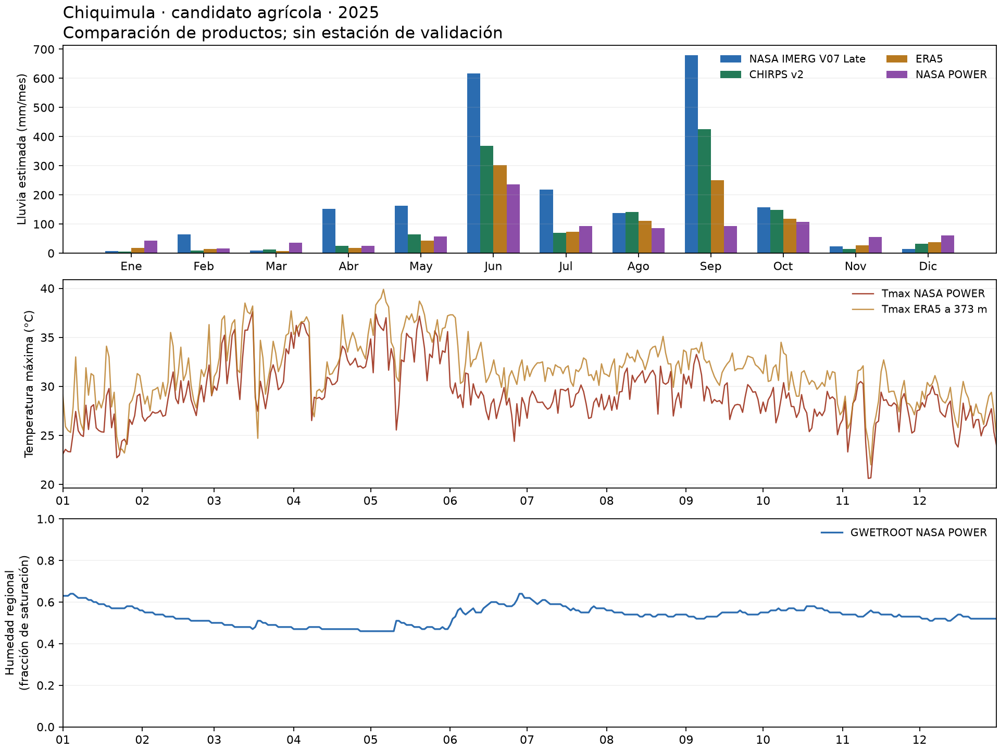
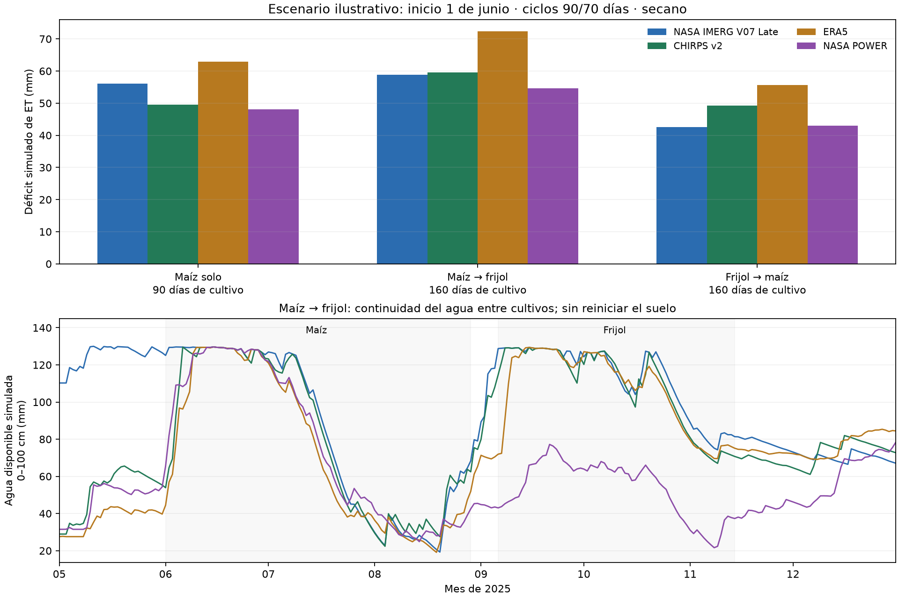

# Chiquimula: reconstrucción del entorno y escenarios de 2025

Corrida exploratoria preparada el **14 de noviembre de 2026**. Se usó el candidato agrícola de GitHub **14.8250, −89.5312**, elegido por el usuario para este ejercicio. Los datos meteorológicos cubren el **1 de enero al 31 de diciembre de 2025**. Es una reconstrucción histórica con resultados conocidos después del año; no un pronóstico que hubiera estado disponible al decidir.

**Resultado:** quedaron descargadas las series diarias, un perfil de suelo del nuevo punto y 1,728 corridas de agua/calendario para maíz solo, maíz→frijol y frijol→maíz. Esto permite estudiar viabilidad hídrica bajo supuestos explícitos. La compatibilidad sanitaria, el rendimiento, la rentabilidad y la aptitud de las otras 16 especies siguen sin resolverse con esta corrida.

## Lugar y representatividad

El punto está dentro de un polígono de aproximadamente **102.3 ha** que el mapa MAGA de cobertura 2025 clasifica como **maíz y frijol**. El polígono es una unidad temática, no el tamaño ni los linderos de una finca individual. Las capas ya descargadas del MAGA lo sitúan en **abanicos aluviales**, Inceptisoles y capacidad de uso III agrícola. Son categorías cartográficas regionales, sin diagnóstico de drenaje o profundidad física.

El DSM JAXA AW3D30 indica **373 m** de elevación y aproximadamente **2.6%** de pendiente local, calculada en una ventana de 3×3 píxeles. Un DSM incluye árboles y construcciones. La ubicación es consistente con estudiar un sector bajo del paisaje; no se modelaron nivel freático, inundaciones ni circulación de aire de un valle. WorldCover 2021 identifica pastizal en el punto, mientras MAGA 2025 indica maíz/frijol: la diferencia requiere comprobación de campo y no se resolvió suponiendo que uno estuviera equivocado.



## Datos obtenidos y procedencia

| Fuente | Variables utilizadas o conservadas | Alcance |
|---|---|---|
| [NASA POWER Daily, AG](https://power.larc.nasa.gov/docs/services/api/temporal/daily/) | Temperatura media/máxima/mínima, rocío, humedad relativa, viento a 2 m, radiación, precipitación, presión, GWETTOP/GWETROOT/GWETPROF y EVLAND. | 14 variables, 365 fechas completas. Meteorología regional MERRA-2 y radiación de otra cuadrícula; no sensor de parcela. ET₀ se calculó con meteorología POWER y ecuaciones FAO-56, sin confundir EVLAND con ET₀. |
| [NASA GPM IMERG V07 Late](https://gpm.nasa.gov/data/imerg), servido por [ClimateSERV, id 226](https://climateserv2.servirglobal.net/develop-api) | Lluvia diaria, promedio espacial solicitado en un cuadro de ±0.015° alrededor del punto. | 365 días; producto de aproximadamente 0.1°. Es **Late**, no Final. El promedio de un cuadro pequeño no mejora su resolución nativa. |
| [UCSB CHIRPS v2](https://www.chc.ucsb.edu/data/chirps), ClimateSERV id 0 | Lluvia diaria de satélite y estaciones. | 365 días; aproximadamente 0.05°. Fuente de UCSB, servida por la plataforma SERVIR. Se conservó v2; UCSB ya dispone de v3. |
| [ERA5 vía Open-Meteo](https://open-meteo.com/en/docs/historical-weather-api) | Lluvia y temperaturas diarias, ET₀ de comparación; humedad volumétrica horaria en 0–7, 7–28 y 28–100 cm, agregada a media diaria. | Modelo explícito `era5`, celda devuelta 14.75, −89.5. Se solicitó elevación de 373 m y zona America/Guatemala. Es reanálisis modelado, no observación de finca. |
| [ISRIC SoilGrids 2.0, WCS](https://docs.isric.org/globaldata/soilgrids/SoilGrids_faqs_02.html) | Retención de agua a 33 y 1500 kPa y fragmentos en cinco capas hasta 1 m; textura, pH, carbono y densidad superficiales. | 21 recortes TIFF pequeños. Predicción estática de aproximadamente 250 m, remuestreada por WCS a EPSG:4326; no suelo medido en 2025. La API REST está pausada; se utilizó WCS. |
| [MAGA Geoportal](https://geoportal.maga.gob.gt/), JAXA AW3D30 y ESA WorldCover | Uso temático, fisiografía, suelo cartográfico, relieve y cobertura. | Se consultaron los archivos ya presentes en el repositorio. No se usaron capas de vulnerabilidad de 2026 para simular resultados de 2025. |

Los originales, las URL de solicitud, los identificadores de trabajo y los hashes están en [datos/escenarios/chiquimula_2025](../../datos/escenarios/chiquimula_2025). Los cortes horarios de IMERG/CHIRPS, POWER LST y ERA5 local difieren; las comparaciones se hacen por fecha publicada y ventanas de días, sin asegurar coincidencia de la hora exacta de cada evento.

NASA recomienda IMERG **Final** para investigación cuando la latencia no es una restricción. Esta extracción accesible de ClimateSERV entrega **V07 Late**; el contraste con otras fuentes es necesario y no sustituye Final ni una estación local. [NASA, diferencias entre corridas](https://gpm.nasa.gov/data/directory).

## Qué se encontró en 2025

Estos son episodios calculados dentro de las series, sin atribuirles un nombre oficial de desastre o canícula:

| Episodio seleccionado | Fechas | Dato y utilidad para el escenario |
|---|---|---|
| Ventana de 14 días con mayor promedio de Tmax de POWER | **14–27 de mayo** | Tmax diaria media **34.3 °C**; pico de esa ventana **37.2 °C**. Permite explorar establecimiento bajo calor; no diagnostica daño de una variedad. |
| Mayor racha con P<1 mm/día entre mayo y octubre, coincidente en IMERG y CHIRPS | **15–25 de julio** | **11 días**. Acumulado de 0.6 mm en IMERG y 0 mm en CHIRPS. Permite ubicar el déficit frente a las etapas de cada calendario. ERA5 y POWER identifican otras rachas máximas; el episodio depende del producto. |
| Semana de mayor lluvia, coincidente en IMERG y CHIRPS | **17–23 de septiembre** | **296.8 mm** y **186.9 mm**, respectivamente. Permite examinar excedentes del balance y exposición a lluvia. No se convierte en inundación o enfermedad observada. |

La precipitación anual estimada fue **2,243.5 mm IMERG Late**, **1,317.7 mm CHIRPS**, **1,020.5 mm ERA5** y **909.8 mm POWER**. No se promediaron estas cifras para crear una supuesta verdad de la parcela ni se eligió una fuente por dar el resultado más favorable.

La diferencia de temperatura también importa: el máximo anual de POWER fue **37.6 °C**, frente a **39.9 °C** en ERA5 con la elevación solicitada. La elevación regional informada por POWER es 762.46 m; el DSM local indica 373 m. Se estimó la presión para ET₀ por elevación con FAO-56; no se corrigió artificialmente toda la temperatura de POWER ni se afirmó representar un microclima de valle.



## Suelo estimado del candidato

La superficie presenta **45.0% arena, 28.6% limo y 26.4% arcilla**, pH aproximado **7.0**, carbono orgánico **22.8 g/kg** y densidad aparente **1.40 g/cm³**. Son predicciones cartográficas. No entregan N disponible, salinidad, compactación, conductividad hidráulica o presencia de patógenos.

El agua disponible calculada entre retención a 33 y 1500 kPa suma **130.7 mm en 0–100 cm**, con estas contribuciones:

| Capa | Agua disponible estimada |
|---|---:|
| 0–5 cm | 7.05 mm |
| 5–15 cm | 13.40 mm |
| 15–30 cm | 21.15 mm |
| 30–60 cm | 38.70 mm |
| 60–100 cm | 50.40 mm |

La reserva accesible cambia con las raíces. No se impuso 1 m de raíces al frijol: la referencia máxima usada fue 0.6 m para frijol y 1 m para maíz, con crecimiento gradual supuesto. También se evaluó una limitación de ambas raíces a 40 cm y una reducción del almacenamiento de 25%, como sensibilidades elegidas por el analista, sin interpretarlas como probabilidades o intervalos de confianza.

## Modelo y escenarios

Se utilizó un **balance diario simplificado en cinco capas**, inspirado en [FAO-56](https://www.fao.org/4/x0490e/x0490e00.htm). La lluvia que no se asigna a escorrentía llena las capas y el exceso sale como drenaje profundo del modelo. ET₀ determina la demanda; Kc representa el calendario del cultivo y Ks reduce la extracción cuando falta agua. El perfil se conserva al cambiar de cultivo. El déficit informado es **ET potencial menos ET simulada durante el cultivo**, en milímetros; no equivale a pérdida de rendimiento ni a una dosis de riego.

Las 1,728 combinaciones son:

- Tres secuencias: maíz solo, maíz→frijol y frijol→maíz.
- Cuatro fuentes alternativas de lluvia, con la misma ET₀ calculada a partir de POWER para aislar ese cambio.
- Cuatro calendarios: referencia FAO de 125/95 días desde el 15 de mayo; ciclos cortos ilustrativos de 90/70 días desde el 15 de mayo, 1 de junio o 15 de junio.
- Tres estados físicos supuestos: perfil de referencia, raíces limitadas a 40 cm o almacenamiento 25% menor.
- Escorrentía supuesta de 0%, 15% o 30%; dos reservas iniciales al 1 de enero, 25% o 75% del agua disponible.
- Secano o riego hipotético de 20 mm netos cuando se rebasa el umbral de agotamiento, sin límite estacional de suministro. Este tratamiento explora demanda; no recomienda esa dosis ni supone que el productor disponga de ella.

**El fin del ciclo representa terminación/retiro supuestos.** Los 90 días del maíz no garantizan grano seco ni terreno liberado; las etapas Kc de los ciclos cortos se prorratearon y no están calibradas para ICTA B-5/Ligero. Entre cultivos se dejaron siete días completos. Si el maíz queda en pie hasta noviembre, una siembra de frijol en septiembre debe analizarse como relevo o con otro calendario. Tampoco se asumió que un resultado hídrico favorable resolviera ese problema operativo.

## Una comparación concreta

Para visualizar el efecto del orden se fijó: inicio **1 de junio**, ciclos **90 días maíz / 70 días frijol**, intervalo de siete días, perfil de referencia, escorrentía supuesta de 15%, reserva inicial de 25% y **secano**.

| Fuente de lluvia | Déficit ET maíz→frijol | Déficit ET frijol→maíz | Días Ks<0.95, respectivamente |
|---|---:|---:|---:|
| NASA IMERG V07 Late | 58.9 mm | 42.6 mm | 35 / 23 |
| CHIRPS v2 | 59.6 mm | 49.3 mm | 46 / 24 |
| ERA5 | 72.4 mm | 55.6 mm | 54 / 30 |
| NASA POWER | 54.7 mm | 43.0 mm | 46 / 29 |

En esta comparación, **frijol→maíz presentó menor déficit con las cuatro fuentes**. Esto permite priorizar una hipótesis para estudiar, sin declarar mayor rendimiento, beneficio económico o compatibilidad sanitaria. En las variantes también existen excepciones; contar combinaciones elegidas por el analista no estima una probabilidad de éxito.

Con CHIRPS, maíz→frijol sitúa maíz entre **1 de junio y 29 de agosto**, y frijol entre **6 de septiembre y 14 de noviembre**. El orden inverso sitúa frijol entre **1 de junio y 9 de agosto**, y maíz entre **17 de agosto y 14 de noviembre**. Son calendarios ilustrativos distintos sobre el mismo año y perfil inicial, no siembras observadas.

El caso de maíz solo tiene 90 días de cultivo y las secuencias tienen 160. Su déficit acumulado no permite comparar producción equivalente; se conserva como referencia del primer cultivo. La cifra de 20 mm del tratamiento de riego tampoco debe confundirse con el déficit acumulado: el disparo preventivo, la evaporación y el estado final cambian el volumen aplicado.



## Qué puede concluir el asesor

Puede consultar el entorno estimado de 2025, ubicar el calor y las rachas de lluvia, comparar fechas y necesidades de agua bajo los supuestos y señalar qué dato falta para evaluar una sucesión. Debe conservar las reglas sanitarias de [la matriz auditada](../../datos/cultivos/compatibilidad_sucesiones.json): los resultados siguen con `requiere_evaluacion_local_y_sanitaria`.

Las API usadas no verifican especie/población de nematodos, patógenos, semilla sana, sanidad del rastrojo, profundidad física, riego realmente entregable ni fecha real de retiro. La humedad relativa o GWET no sustituyen esas observaciones. GWET es saturación regional adimensional; la humedad ERA5 es volumétrica modelada y el balance produce una tercera estimación. No se trataron como mediciones equivalentes ni se calibró el suelo con ellas.

El modelo tampoco representa intensidad de lluvia, ascenso capilar, anegamiento, movimiento lateral, salinidad, nutrientes, mortalidad por estrés ni cambios de duración por temperatura. Estas limitaciones son relevantes para un terreno bajo. La temperatura sirve como exposición descriptiva en esta versión, sin función de daño térmico calibrada. No se entrenó una red neuronal ni se generaron etiquetas de compatibilidad aprobada.

## Archivos, controles y reproducción

- [Entorno diario de 2025, CSV](../../datos/escenarios/chiquimula_2025/entorno_diario_2025.csv).
- [Sitio y suelo, JSON](../../datos/escenarios/chiquimula_2025/sitio_y_suelo.json).
- [Episodios y resumen mensual](episodios_2025.json).
- [Resultados de 1,728 escenarios, CSV](resultados_escenarios.csv) y [JSON con resultados por cultivo](resultados_escenarios.json).
- [Comparación de referencia, CSV](comparacion_referencia.csv).
- [Balances diarios de 24 casos de referencia, CSV](balance_diario_escenarios_referencia.csv).
- [Método, supuestos, versiones y hashes](metodo_y_validacion.json).

La validación informática comprobó 365 fechas completas por fuente y conservación del agua en **630,720 pasos diarios**, con residuo máximo menor de **10⁻⁷ mm**. Pasaron cuatro pruebas de límites físicos: conservación sin flujos, ausencia de evaporación con suelo vacío, drenaje del exceso y contabilidad del riego. Las figuras se inspeccionaron visualmente. Estos controles no sustituyen la validación con estación, sensores o resultados de finca.

Desde la raíz del repositorio, con Node.js y Python:

```powershell
node scripts/descargar_escenario_chiquimula_2025.cjs
# Consultar después el avance de las dos solicitudes, sin volver a enviarlas:
node scripts/descargar_escenario_chiquimula_2025.cjs --poll
node scripts/descargar_suelo_escenario_2025.cjs
python -m pip install -r requirements-simulacion.txt
python scripts/simular_chiquimula_2025.py
python -m unittest discover -s tests -v
```

Los originales quedan en caché; conservar `descargas.json` y los archivos `*_progreso.json` para reconocer la extracción. Si ClimateSERV aún no termina, consultar de nuevo `--poll` antes de ejecutar el modelo. Los dos TIFF estáticos y las capas MAGA utilizados para el sitio ya pertenecen al repositorio. Los scripts no publican resultados en GitHub.
