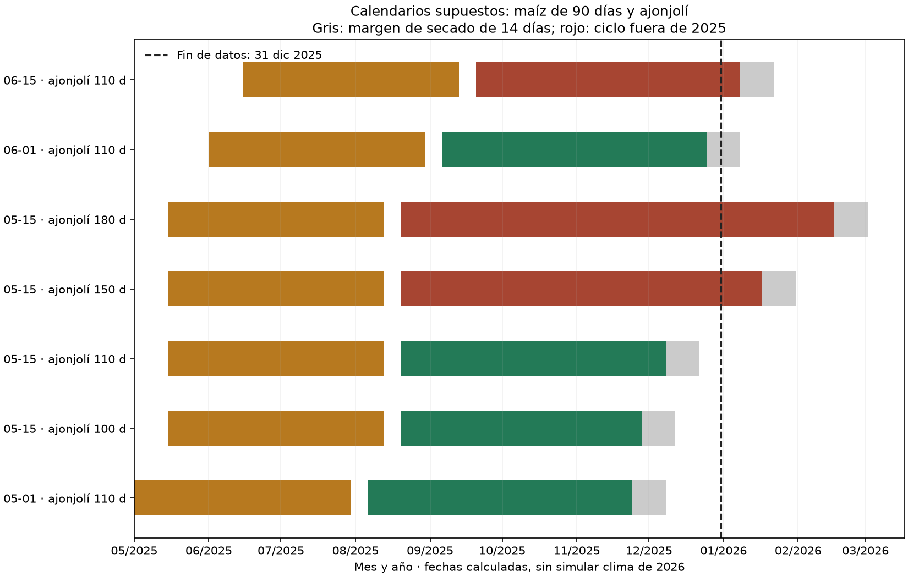
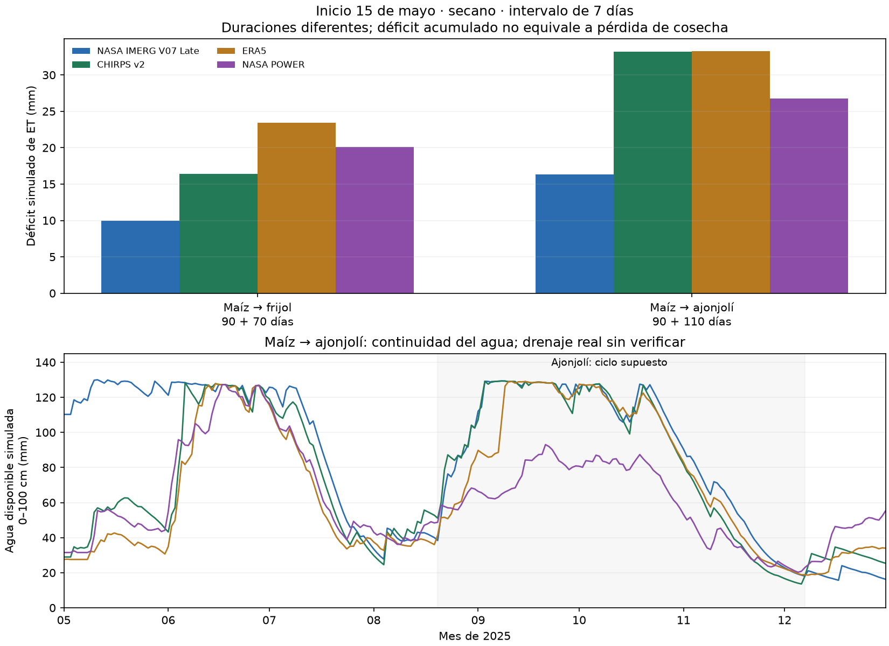

# Auditoría maíz → ajonjolí · Chiquimula · 2025

**Fecha:** 15 de noviembre de 2026. Alternativa seleccionada de la imagen del usuario: **maíz→ajonjolí**. Se conserva el candidato agrícola **14.8250, −89.5312** y las mismas series de 2025 de la [prueba frijol–maíz](../prueba%20frijol%20maiz%202025/README.md).

**Dictamen:** es una alternativa para investigar, condicionada a variedad, retiro del maíz, ventana del ajonjolí, drenaje y comprador. Esta auditoría no la aprueba como rotación de la parcela. Se comprobaron fuentes botánicas/agronómicas, se evaluaron calendarios y se ejecutaron **3,312 combinaciones hídricas** completas dentro de 2025. La meteorología no permite verificar sanidad, anegamiento real ni venta de la cosecha.

## Qué se auditó

| Comprobación de la alternativa | Resultado | Qué sigue faltando |
|---|---|---|
| Adaptación | *Sesamum indicum* L., Pedaliaceae, identidad confirmada. Hay producción y mejoramiento de ajonjolí en Guatemala; el punto tiene 373 m y pH superficial cartográfico aproximado de 7. | Material local, comportamiento en Chiquimula, establecimiento, sanidad y profundidad física. Presencia nacional y cambio de familia no demuestran aptitud de finca. |
| Calendario | De **32 programas de maíz→ajonjolí**, nueve completan el ciclo supuesto dentro de 2025; cinco conservan además un margen de secado de 14 días. | Duración real de la variedad, cosecha seca y fecha efectiva de retiro del maíz. Los otros calendarios quedan sin evaluación hídrica completa; no se extrapoló el clima a 2026. |
| Drenaje | La bibliografía de extensión documenta sensibilidad al anegamiento. El perfil estimado permite calcular reserva de agua, pero no cuánto tarda en drenar el terreno. | Infiltración, nivel freático, agua estancada después de lluvia y manejo. El motor supone drenaje instantáneo del exceso: no valida esta condición. |
| Comprador | Existen fichas oficiales de comercialización y calidad; no se identificó comprador de esta parcela. | Variedad/color, calidad y humedad aceptada, volumen, unidad, entrega, precio, secado y flete. No se calculó margen ni se sustituyó un contrato con precio mayorista. |

## Fuentes comprobadas y hallazgos

El [registro de evidencia](fuentes/evidencia_bibliografica.json) distingue lectura de texto, ficha de catálogo y límites. Los [parámetros por campo](datos/cultivos/parametros_auditados.json) conservan procedencia y supuestos.

1. **Identidad botánica.** [POWO–Kew](https://powo.science.kew.org/taxon/675971-1) acepta *Sesamum indicum* L. en Pedaliaceae. El maíz corresponde a Poaceae. Esto describe parentesco y no concede un bono automático de compatibilidad.
2. **Parámetros de agua.** [FAO-56, tabla 12](https://www.fao.org/4/x0490e/x0490e0b.htm) aporta Kc medio/final 1.10/0.25; el inicial 0.35 procede del grupo de oleaginosas. La [tabla 22](https://www.fao.org/4/x0490e/x0490e0e.htm) da raíz de referencia 1.0–1.5 m y p=0.60. Se usó 1 m por el perfil disponible, sin inventar agua a mayor profundidad. Son referencias sin calibración local.
3. **Inconsistencia de duración.** La fila Sesame de la **tabla 11 HTML** de FAO muestra etapas de **20, 30, 40 y 20 días**, que suman **110**, mientras su columna total dice **100**. Se conservó esta diferencia: 110 días por suma y 100 días con etapas reescaladas como sensibilidad. No se afirma haber corregido todas las ediciones del libro.
4. **Referencia guatemalteca distinta.** Una [ficha de mercado MAGA, fuente 2017](https://www.maga.gob.gt/sitios/diplan/download/informacion_del_sector/fichasdemercado/Ajonjol%C3%AD%20de%20Primera%20Mayorista.pdf) registra **150–180 días**. Es antigua, comercial y no identifica variedad ni ensayo de esta finca; se evaluó su implicación para el calendario sin imponerla como fenología de Chiquimula. El pasaje se contrastó en el original extraído por web; la descarga directa devolvió 403.
5. **Establecimiento y cosecha.** La [guía de NC State, publicada el 23/03/2026](https://content.ces.ncsu.edu/sesame-production-fact-sheet), basada en su experiencia y ensayos, advierte sobre anegamiento, residuos que dificultan implantación y secado posterior a madurez. Sus referencias de madurez alrededor de 100 días y secado adicional de 7–14 días son de Carolina del Norte. Se empleó 14 días solo como sensibilidad de calendario, sin trasladar sus fechas de siembra a Guatemala. Es bibliografía consultada retrospectivamente en 2026.
6. **Presencia local y mercado.** [ICTA, Memoria 2023](https://www.icta.gob.gt/publicaciones/Memoriasicta/Memoria%20de%20Labores%20ICTA%202023.pdf) documenta mejoramiento y ensayos de ajonjolí en el sur del país. La denominación «programa maíz/ajonjolí» no demuestra que se haya ensayado esta sucesión. La [ficha de caracterización MAGA](https://precios.maga.gob.gt/archivos/fichas/fichasproducto/Ajonjol%C3%AD.pdf) documenta calidad, unidades y precios mayoristas de 2019–2024; no acredita comprador, precio de finca o rentabilidad en 2025.

La ficha agroclimática MAGA de 2024 se verificó **solo en catálogo** y no se utilizó para inventar umbrales. Una tesis USAC localizada al buscar la rotación estudia proteína y aceite del grano; se excluyó como ensayo de sucesión. No se encontró en esta revisión selectiva un experimento de campo que valide maíz→ajonjolí para el candidato de Chiquimula. Esto no afirma que no exista literatura adicional.

## Entorno y comparabilidad

Se reutilizaron los originales de la primera prueba: **365 días** de NASA POWER, IMERG V07 Late, CHIRPS v2 y ERA5; 21 recortes SoilGrids; y archivos MAGA, JAXA y WorldCover. No se volvieron a consultar las API ni se modificó la prueba anterior. Los registros de las descargas se conservan en [datos/escenarios/chiquimula_2025](datos/escenarios/chiquimula_2025).

El punto está dentro de una unidad MAGA de maíz/frijol de aproximadamente 102.3 ha, sin linderos de finca verificados. La cartografía lo sitúa en abanicos aluviales; el DSM indica 373 m y pendiente local aproximada de 2.6%. SoilGrids estima 45.0% arena, 28.6% limo, 26.4% arcilla y **130.7 mm de agua disponible en 0–100 cm**. Son estimaciones espaciales, sin medición de compactación, salinidad, nutrientes disponibles o drenaje. No se afirma que hubiese ajonjolí sembrado allí en 2025.

En IMERG y CHIRPS coinciden una racha con P<1 mm/día del **15–25 de julio**, y la semana más lluviosa del **17–23 de septiembre**. Sus totales anuales divergen: 2,243.5 y 1,317.7 mm; ERA5 y POWER dan 1,020.5 y 909.8 mm. Se conservaron las cuatro alternativas de lluvia, sin elegir una por conveniencia ni tratarlas como mediciones de finca. IMERG es **Late, no Final**. GWET regional, humedad volumétrica ERA5 y agua simulada no se igualaron entre sí.

El motor es la misma contabilidad de cinco capas de la primera prueba, separada ahora como [módulo base](scripts/motor_hidrico_base.py). Una prueba de regresión reprodujo el comparador de frijol publicado con las cuatro lluvias. Las diferencias se atribuyen al cultivo/calendario y a los supuestos explícitos de la nueva corrida, no a cambiar silenciosamente la meteorología.

## Calendarios: qué cabe dentro de 2025

Se definieron **48 programas**: maíz solo, maíz→frijol y maíz→ajonjolí; cuatro inicios (1/15 de mayo, 1/15 de junio), maíz de 90 o 125 días y ajonjolí de 100/110/150/180 días. Los ciclos de 150/180 se reescalaron únicamente para sensibilidad. Se dejó un intervalo de **siete días completos** entre cultivos. Los ciclos del maíz son retiros supuestos: madurez no garantiza grano seco ni terreno libre.

**23 programas** completan el ciclo antes del 31/12/2025 y se simularon. **25** exceden los datos disponibles y solo tienen evaluación de fechas. Por cada programa completo se corrieron 144 combinaciones: cuatro lluvias, tres hipótesis de suelo/raíces, tres escorrentías supuestas, dos reservas iniciales y secano/riego hipotético. Son **3,312 corridas**, no 3,312 ensayos ni probabilidades de éxito.

Ejemplo con maíz de 90 días desde el 15 de mayo, retiro supuesto el 12 de agosto y ajonjolí desde el 20 de agosto:

| Duración supuesta del ajonjolí | Fin del ciclo | Fin con margen adicional de 14 días | Alcance con datos de 2025 |
|---|---|---|---|
| 100 días | 27/11/2025 | 11/12/2025 | Ciclo y margen dentro del año. |
| 110 días | 07/12/2025 | 21/12/2025 | Ciclo y margen dentro del año. |
| 150 días | 16/01/2026 | 30/01/2026 | Sin simulación completa; requiere datos posteriores. |
| 180 días | 15/02/2026 | 01/03/2026 | Sin simulación completa; requiere datos posteriores. |

Con inicio del maíz el **1 de junio** y ajonjolí de 110 días, este segundo cultivo va del **6 de septiembre al 24 de diciembre**; el margen de secado llega al **7 de enero de 2026**. Completar el ciclo supuesto no equivale a verificar cosecha seca antes de terminar 2025.



## Resultado hídrico de referencia

Se fijaron inicio del maíz **15 de mayo**, maíz de 90 días, frijol de 70 o ajonjolí de 110 días, perfil de referencia, escorrentía supuesta de 15%, reserva inicial de 25% al 1 de enero y **secano**:

| Fuente de lluvia | Déficit ET total maíz→frijol | Déficit ET total maíz→ajonjolí |
|---|---:|---:|
| NASA IMERG V07 Late | 10.0 mm | 16.3 mm |
| CHIRPS v2 | 16.4 mm | 33.2 mm |
| ERA5 | 23.4 mm | 33.3 mm |
| NASA POWER | 20.1 mm | 26.7 mm |

El calendario de ajonjolí dura **40 días más**. Su mayor déficit acumulado en este ejemplo no prueba inferioridad de rendimiento o rentabilidad; sí muestra que tolerancia a sequía no justifica asignar compatibilidad automática. El déficit es demanda de ET menos ET simulada durante el cultivo, no pérdida de grano ni dosis de riego.



Mover el inicio al **1 de junio**, manteniendo los demás supuestos, produce para maíz→ajonjolí un déficit total de **71.3–106.5 mm** entre las cuatro lluvias. Durante los primeros 20 días del ajonjolí, CHIRPS/IMERG estiman **361.3/598.1 mm**: es exposición a lluvia, **no anegamiento observado**. El motor drena instantáneamente el exceso sobre capacidad; esa simplificación puede ocultar un problema crítico para el ajonjolí. Tampoco se modelaron mortalidad, temperatura del suelo o daño por calor.

## Decisión que permite esta auditoría

**Mantener la alternativa como condicionada.** Una ventana temprana con un material corto podría justificar un piloto controlado, una vez verificadas adaptación y operaciones reales. Con materiales más largos o retiro tardío del maíz, el ejercicio queda fuera de 2025 o exige evaluar otro calendario. No se transforma un calendario que no cabe en una declaración de incompatibilidad botánica.

Antes de recomendar hacen falta:

- Variedad, duración y secado reales; retiro del maíz, residuos y capacidad de establecer la semilla pequeña. Si A permanece cuando se siembra B, es relevo fuera de esta sucesión estricta.
- Observación de drenaje, suelo y antecedentes sanitarios. La ausencia de alerta en la matriz documental no es diagnóstico negativo ni prueba de ruptura de plagas.
- Comprador y condiciones de calidad/entrega. Las API meteorológicas y precios mayoristas no responden quién comprará, cuánto pagará al productor ni con qué costos.

No se asignó puntuación universal, beneficio fijo por familia, N residual, precio de finca ni compatibilidad aprobada. El riego simulado de 20 mm al superar el agotamiento umbral es hipotético, sin tope estacional de suministro; no es una recomendación de dosis.

## Archivos y reproducción

- [Parámetros y fuentes por campo](datos/cultivos/parametros_auditados.json).
- [Evidencia bibliográfica y límites de lectura](fuentes/evidencia_bibliografica.json).
- [Calendarios completos e inconclusos](resultados/calendarios_evaluados.csv).
- [Resultados de las 3,312 corridas, CSV](resultados/resultados_escenarios.csv).
- [Resultados estructurados comprimidos](resultados/resultados_escenarios.json.gz) y [balances diarios de referencia](resultados/balances_referencia.csv.gz).
- [Comparación de referencia por cultivo](resultados/comparacion_referencia.json).
- [Método, supuestos y hashes de entrada](resultados/metodo_y_validacion.json).
- [Control de entrega](control_paquete.json) e [inventario](inventario.json).

Los PDF consultados se identifican por su enlace oficial y registro de acceso; no se republican dentro de este paquete. La matriz documental incluida conserva rutas de contexto del proyecto original; no es la etiqueta del modelo.

En PowerShell, desde la raíz del repositorio:

```powershell
Set-Location -LiteralPath 'auditorias/prueba maiz ajonjoli 2025'
python -m venv .venv
.\.venv\Scripts\python.exe -m pip install -r requirements-simulacion.txt
.\.venv\Scripts\python.exe scripts/auditar_maiz_ajonjoli_2025.py
.\.venv\Scripts\python.exe -m unittest discover -s tests -v
```

Los originales están incluidos y no hace falta una nueva descarga. Se aprobaron **ocho pruebas** de parámetros, límites temporales, intervalo, conservación de agua y regresión del comparador. El cierre de agua de **1,208,880 pasos diarios** tuvo residuo máximo menor de **10⁻⁷ mm**. Las figuras se inspeccionaron. Estos controles prueban integridad y contabilidad, sin validación de campo ni entrenamiento de una red neuronal.
